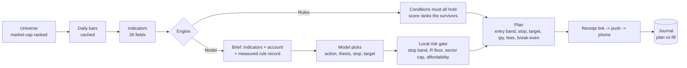

<div align="center">


<h1>Kestrel 隼</h1>

**Watch first. Then act.**

A self-hosted, multi-market stock screener and trading journal that keeps you honest.<br/>
For people who hold A-shares, Hong Kong and US names in the same week.

<br/>

[](https://github.com/jukkakakaka/kestrel/actions/workflows/ci.yml) [](LICENSE) [](pyproject.toml) [](#install)

[English](README.md) · [简体中文](README.zh-CN.md) · [Docs](docs/) · [Engines](docs/engines.md) · [Architecture](docs/architecture.md)


</div>

---

Most tools help you **find** a trade. Kestrel asks the harder question afterwards:
**did you actually follow your plan?**

Every plan carries an entry band, a stop, a target, a share count, fees, a true break-even
price and a deadline. It reaches your phone with a one-tap receipt page. Tap *executed*,
type the fill price, and the gap between plan and behaviour becomes a number you can work on.

And, less comfortably: **it tells you whether its own rules make money.** Seven rules ship
with the app; the ones that measured as no better than doing nothing were switched off
instead of being quietly published as advice.

## One switch, three engines

Who produces advice is a single setting. There is one button on the advice page, and its
label follows that setting.

| Engine | Decides | Latency | Cost |
| :--- | :--- | :--- | :--- |
| **Rules** | fixed conditions over indicators | instant | free |
| **Model** (OpenAI-compatible) | reads indicators, your account and the measured record of every rule, then picks | ~30 s | per token |
| **WorkBuddy** | same, but over a file queue serviced by a scheduled agent | minutes | free |

In both AI modes **risk and position sizing stay in local code**: the model's share count is
discarded, the stop must sit 1.5%–15% below entry, reward must clear 1.5R, the ticker must
exist in the candidate list, and one sector may not dominate. Rejected picks are logged with
a reason and shown in the UI — a model that gets filtered is more informative than one that
looks flawless.

Every card states its origin: `AI · deepseek-chat · conviction 68` or `Trend pullback · strength 80%`.

## What it does

- **Three markets, independently switched** — A-shares, Hong Kong, US. Turn off the ones you do not trade.
- **Screening, not just monitoring** — each run draws from a market-cap ranked pool per market
  (30 by default), not only from your existing positions. A cold run evaluates ~85 symbols; warm
  cache finishes in under a second.
- **Rules are data** — a rule is a JSON document: conditions, bonus terms, where the stop and
  target come from. Write, edit and clone them in the UI; saving compiles first, so a typo names
  the field it could not resolve.
- **Rules must prove themselves** — walk-forward folds against a fair benchmark: same entry, same
  holding period, no stop. Anything that cannot beat holding is disabled automatically, kept with
  its history so you can retest it in another regime.
- **Plans you can actually place** — ATR stop, 2R target, whole lots, fees included, break-even
  computed. When one lot alone exceeds the risk budget, the plan is rejected and says so instead
  of vanishing.
- **Receipt loop** — signed short links through ntfy, webhook, WeClawBot or SMTP; fills and
  deviations land back in the database.
- **Trading journal** — open positions, closed trades, IPOs; paste a broker confirmation and it
  parses the fills; discipline stats compare following the plan against breaking it.
- **Cost engine** — exchange levies plus ten broker plans editable in the UI. Know that 10,000 HKD
  round trip costs ~0.55% and 1,000 HKD costs ~3.7%.
- **Learning mode** — every plan expands into *what this is / why now / what if it goes wrong*,
  with a 40-term glossary in plain language and per-term opt-out.
- **Trading calendar** — sessions, holidays, open/closed state and the next tradable close.
- **Bilingual, dark mode, local-first** — zh-CN/en, auto/light/dark, SQLite on disk, no account,
  no telemetry.

## Screenshots

<table>
<tr valign="top">
<td width="50%" valign="top"><br/><sub><b>Markets</b> — session state per exchange, red-up/green-down, links to the original source page</sub></td>
<td width="50%" valign="top"><br/><sub><b>Rules</b> — each rule with per-fold expectancy, excess over holding, and a verdict badge</sub></td>
</tr>
</table>

## Install

**Prebuilt app (macOS 11+)**

Download `Kestrel-0.1.0.dmg` from the latest release, drag it to Applications. The bundle is
ad-hoc signed, so the first launch needs the quarantine flag removed:

```bash
xattr -dr com.apple.quarantine /Applications/Kestrel.app
open /Applications/Kestrel.app
```

**From source**

```bash
uv sync --extra desktop   # Python 3.11+
uv run kestrel init
uv run kestrel desktop    # native window + menu-bar icon
# or, if you prefer the browser
uv run kestrel serve      # http://127.0.0.1:8000
```

**Docker**

```bash
docker compose up         # http://127.0.0.1:8000, data in a named volume
```

**Build the app yourself**

```bash
make package              # dist/Kestrel.app
make package-dmg          # dist/Kestrel-0.1.0.dmg
```

The build script generates the icon, signs the bundle, and smoke-tests that a frozen copy
renders `/advice` — an app that starts but serves a blank page is a failure mode worth catching
in CI rather than in your hands.

## How a run works



When nothing qualifies, the page says why — how far the score fell short, which constraint
rejected it — rather than inventing a plan to fill the space.

## Writing a rule

```json
{
  "code": "pullback_quiet",
  "name": "Quiet pullback",
  "conditions": [
    {"left": "ma_stack", "op": "is_true"},
    {"left": "dist_sma20", "op": "between", "value": [-2.5, 0.5]},
    {"left": "rsi14", "op": "between", "value": [40, 62]}
  ],
  "score": {"base": 0.45, "bonus": [
    {"when": {"left": "vol_ratio", "op": "<", "right": 1.15}, "add": 0.2}
  ]},
  "stop":   {"field": "low20"},
  "target": {"field": "high20"}
}
```

`GET /api/rules/schema` returns a JSON Schema, all 26 fields with meanings, operator semantics
and every shipped rule as a worked example. The rules page has a **copy prompt** button built
from those same constants, so any model can author a valid rule without reading this repo.

## Data sources

| Source | Cost | Markets | Notes |
| :--- | :--- | :--- | :--- |
| Eastmoney | free | CN / HK / US | primary, JSON |
| Tencent · Sina | free | CN / HK / US | GBK fallbacks |
| Yahoo | free, no key | CN / HK / US | verified against the others |
| Finnhub · Alpha Vantage · Twelve Data · Polygon · Tiingo | free tier or paid | per provider | paste a key |

Built-in sources can be toggled; disabling one falls through to the next. Custom sources take a
URL template (`{code}` `{market}` `{symbol}` `{yf_symbol}` `{key}`), JSON dot paths, a scale
divisor for milli-unit endpoints, and a **test** button that shows the parsed number before you
save it.

## Configuration

Everything else lives in the database and is edited in the UI. Bootstrap values are environment
variables:

| Variable | Default | Meaning |
| :--- | :--- | :--- |
| `KESTREL_HOME` | `./data`, or `~/Library/Application Support/Kestrel` when bundled | database, cache, logs, bridge queue |
| `KESTREL_HOST` | `127.0.0.1` | bind address |
| `KESTREL_PORT` | `8000` | port |
| `KESTREL_DEBUG` | `false` | verbose logging |

## Honest limits

This is the part most READMEs leave out.

- **Daily bars only.** No order book, no fund flows, no earnings expectations. On that
  information set the selection edge is close to zero, and the rules page will show you exactly
  that: expectancy is positive, but almost all of it comes from the 2:1 payoff, not from the entry.
- **The stop is doing the work.** Measured against holding the same entry for the same number of
  days with no stop, the excess return of every shipped rule is near zero. Treat the app as a
  discipline and cost tool, not an oracle.
- **WorkBuddy mode is asynchronous** and its finest schedule is hourly.
- **OCR is not implemented.** Paste confirmations as text; it is more accurate anyway.
- **Not packaged for Windows CI yet**, though the spec supports it.

## Project layout

```
src/kestrel/
  app.py            FastAPI app, routes, template filters
  services/         scan, analyst, engine, rules, universe, calendar, edge, statement, bridge
  strategies/       rule spec compiler, built-in rule library, AI-facing schema
  datasources/      provider chain, Eastmoney/Tencent/Sina, resolver, presets, custom
  planning/         position sizing, stop/target placement, fee-aware plans
  fees/             exchange levy model, broker plans
  web/              Jinja templates + static assets
  db/               schema and versioned migrations
packaging/          PyInstaller spec, macOS build script, icons
```

## Documentation

| Document | Contents |
| :--- | :--- |
| [docs/engines.md](docs/engines.md) | The three engines, shared risk checks, what each page does in AI mode |
| [docs/architecture.md](docs/architecture.md) | Module map, data flow, storage |
| [docs/fee-model.md](docs/fee-model.md) | Exchange levies and broker plans |
| [docs/notifications.md](docs/notifications.md) | Channels, receipts, signature scheme |
| [docs/ui-map.md](docs/ui-map.md) | Route table and naming rationale |

## Contributing

Issues and pull requests are welcome — see [CONTRIBUTING.md](CONTRIBUTING.md).
`uv run pytest` (86 tests) and `uv run ruff check src tests` must pass.

## Disclaimer

Kestrel is a research and learning tool. It does **not** provide investment advice, forecast
prices, or place orders. Nothing it produces is an offer to buy or sell any security.
Markets carry risk; the decisions are yours. Its most useful feature may be telling you that
today is not the day.

## License

Apache-2.0 © Kestrel contributors
