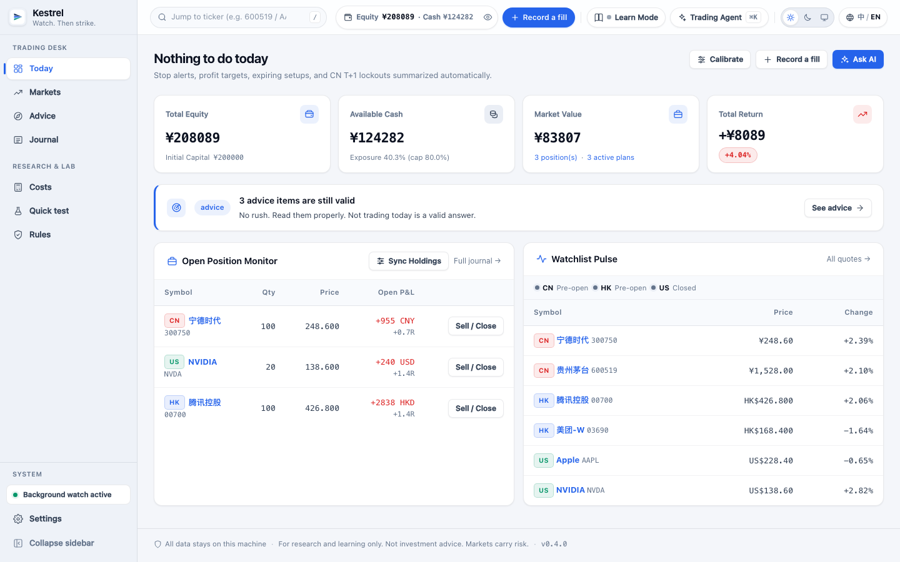
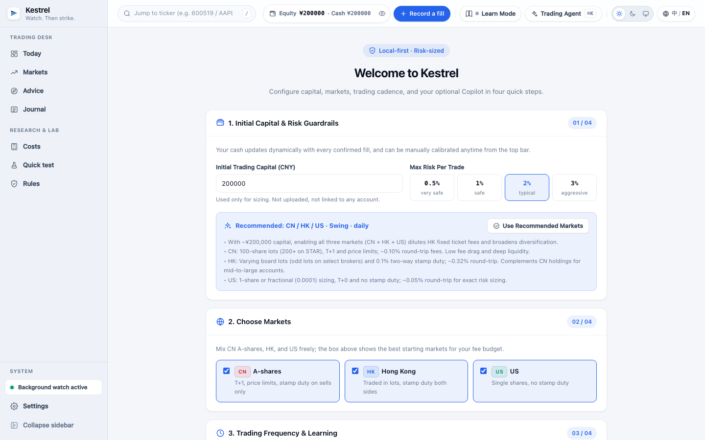

<div align="center">


<h1>Kestrel</h1>

**What to buy today, how much, and when to sell.**

A local-first stock trading and risk workbench that runs on your own machine: it screens China A-shares, Hong Kong, and US stocks, puts strategies through a 4-gate statistical falsification pipeline, builds fee-aware executable plans, logs your *actual* fills, and stays quietly in your system tray to watch stops and targets until positions are closed.

<br/>

[](https://github.com/jukkakakaka/kestrel/actions/workflows/ci.yml) [](LICENSE) [](pyproject.toml) [](#install)

[English](README.md) · [简体中文](README.zh-CN.md) · [Docs](docs/) · [Engines & Falsification](docs/engines.md) · [Architecture](docs/architecture.md) · [UI Map](docs/ui-map.md)



</div>

---

## Getting started

1. Install the desktop app from [GitHub Releases](https://github.com/jukkakakaka/kestrel/releases/latest). Enter your starting capital in CNY. Select any combination of mainland China, Hong Kong and US markets and choose a trading horizon. The defaults explain how account size, typical order sizes, fees and recent market data inform the recommendation.
2. Open **Advice** and start a scan. Check the ticker, entry range, share count, stop, target, estimated fees and expiration on each plan. Symbols with daily data behind the last closed session are skipped. A scan can finish without any actionable plan.
3. Place a limit buy in your broker app after checking the market, currency, quantity and price. Pass if the broker cannot accept the order or the plan conditions no longer hold. Return to Kestrel once the broker confirms a fill.
4. Choose **Record actual fill** and enter the actual price and quantity. If the plan calls for 100 shares and the broker fills 60 at 402.50, record 60 at 402.50. Add later fills separately from the same plan. The advice card shows total filled shares and the weighted average price. Enter fees and the fill date when available. Blank fields use estimated fees and the current time. Expired plans remain available for recording prior fills in history.
5. Check **Today** or **Journal** for positions, cash and risk alerts. After a broker confirms a sell, record it against a specific lot or let the journal match the oldest eligible shares first.

**Learn as you go** is off by default. Turn it on for plain-language advice explanations, an example in **Simulation**, and optional glossary hints. The exercise requires neither a data feed nor a broker account. The AI Copilot is available with a compatible model endpoint.

| Plan field | How to use it |
| :--- | :--- |
| Entry range and shares | Check currency, broker lot rules and available cash before entering a limit order |
| Stop and target | Use them to plan exits. Gaps, halts and liquidity can move the actual fill beyond these levels |
| Estimated round-trip fees and break-even | Check how much price movement it takes to recover costs. Use actual broker fees when recording fills |
| Risk and reward-to-risk | Compare the estimated loss at the stop with the potential gain at the target, using the actual fill for your journal |

## Selling is the main event

Every open position receives **one** clear next action with an exact price attached:

| Trigger | Action | Why |
|---|---|---|
| Price below stop | Exit immediately | A stop is a pre-agreed exit, not a suggestion |
| Reaches `+1R` | Move stop to **break-even** | Worst case becomes a scratch net of fees |
| Reaches `+2R` | Move stop to **`+1R`** | Lock in one risk unit while letting winners run |
| Hits Target 1 | **Sell half (lot-aligned)** | Trail the remainder instead of guessing tops |
| Exceeds horizon max hold | **Time stop** | Dead capital and attention carry opportunity cost |

Stops move **up only** — `exits.apply_stop` rejects downward edits, and every adjustment is audited in `stop_change`.


## Plan → Fill → Journal → Falsification, Closed End-to-End

```
scan → fee-aware plan (entry band / stop / target / shares / fees / break-even / expiry)
     → you execute in your broker app & log actual price/qty (with live drift preview)
     → dynamic cash ledger debits/credits cash; monitor tracks live P&L & R-multiples
     → system tray stays resident in background for stop / near-stop / target alerts
     → partial or full FIFO close → execution quality + What-if P&L attribution + Gate 4 live drift
```


## 4-Gate Quantitative Falsification Pipeline

Most retail tools show cherry-picked backtests. Kestrel treats statistical falsification as a first-class workflow across `/sim` and `/rules`:

1. **G1 Fee & Slippage Filter (`next_open=True`)** — Indicators compute strictly on historical prefixes (`bars[:i+1]`); signals at bar `i` close fill at bar `i+1` **open plus one-way `slippage_bps`** (default `10 bps`) and round-trip `fee_bps` (default `20 bps`), requiring `≥ 12` trades and positive net expectancy.
2. **G2 Walk-Forward vs. Hold** — Multi-fold out-of-sample replay benchmarked against equal-duration unfiltered buy-and-hold.
3. **G3 500-Run Permutation Test & `3×3` Parameter Plateau** — Fixed-seed (`seed=42`, `n_perms=500`, `<150ms`) Monte Carlo permutation testing computes `p_value`; rules with positive walk-forward return but `p ≥ 0.10` are **automatically downgraded from Edge to Unstable**. In `/sim`, a `3×3` grid across hold periods × ATR stop multipliers highlights **Robust Plateaus** vs. **Isolated Overfit Spikes**.
4. **G4 Live / Paper Drift Monitor** — Continuously compares realized average R from historical recommendations and closed journal trades against backtest expectancy, raising a drift warning banner when live results lag significantly (`n ≥ 3`).


## Supported Markets & Five Horizons

| Market | Exchange Mechanics Enforced | Fee Model |
| :--- | :--- | :--- |
| **A-shares (CN)** | `100`-share board lots, STAR/BSE `200+1` sizing, `T+1` sell lock, daily price limits | Commission (0.025%, min ¥5) + 0.05% sell stamp duty + transfer fee |
| **Hong Kong (HK)** | Variable board lots (100/500/1000), no price limits; optional broker odd-lot support | Commission + platform fee + **0.1% stamp duty each side** + 4 levies |
| **US Equities (US)** | Single shares + optional `0.0001` fractional shares & min-dollar checks; no stamp duty | Per-share platform fee + sell-side SEC / TAF fees |


| Horizon | Bar Size | Typical Hold | Plan Expiry | Valid Stop Band |
| :--- | :--- | :--- | :--- | :--- |
| Fast (`fast`) | Daily bars | 1–5 sessions | Next session close | 1.2%–8% |
| Swing (`short`) | Daily | Days to 2 weeks | Next session close | 1.5%–15% |
| Position (`medium`) | Weekly | Weeks to 2 months | 10 days | 3%–18% |
| Long (`long` · Beta) | Monthly | Months | 45 days | 5%–30% |

In `auto` mode, the advisor scores pool breadth, volatility, capital, and broker fee drag to pick the optimal horizon and explain why.

## Three Engines, Shared Local Risk Guardrails

| Engine | Decision Maker | Latency | Cost |
| :--- | :--- | :--- | :--- |
| **Rules** | Deterministic JSON indicator specs editable and falsifiable in `/rules` | Instant | Free |
| **Model** (OpenAI-compatible) | Evaluates candidate indicators, account constraints, and rule falsification records | ~30 s | Per token |
| **WorkBuddy** | Asynchronous file-queue workflow consumed by external scheduled agents | Minutes | Free |

In both AI modes, **position sizing and hard risk checks stay 100% in local Python code**: model share counts are discarded, stops must sit inside the horizon band, net reward-to-risk must clear `1.5`, tickers must come from the candidate whitelist, and daily call budgets fail loudly rather than silently falling back to rules.

## Install & Desktop Background Mode

**macOS Desktop App** (macOS 11+, Apple Silicon & Intel)

Download `Kestrel-*.dmg` from [Releases](https://github.com/jukkakakaka/kestrel/releases) and drag **Kestrel** into Applications. Clear the ad-hoc quarantine attribute once before first launch:

```bash
xattr -dr com.apple.quarantine /Applications/Kestrel.app
open /Applications/Kestrel.app
```

- **Menu Bar Tray & Resident Watch**: Kestrel places a native icon in the macOS menu bar with 7 actions (*Open Kestrel Window*, *Open in Browser*, *Background Watch Active*, *Scan Markets Now*, *Mask Monetary Amounts*, *Keep Running on Window Close*, *Quit Kestrel*). Closing the window hides it to the tray by default; click the menu bar or Dock icon anytime to reopen.
- **Build from source on macOS**:
  ```bash
  make package        # builds dist/Kestrel.app in an isolated .build-venv
  make package-dmg    # builds dist/Kestrel.app + dist/Kestrel-0.4.0.dmg with built-in smoke test
  ```

**From Source** (Python 3.11+, [uv](https://docs.astral.sh/uv/))

```bash
uv sync --extra desktop
uv run kestrel init
uv run kestrel desktop               # 1360×860 native window + system tray
uv run kestrel desktop --minimized   # start hidden in system tray for silent background watch
uv run kestrel serve                 # local browser mode: http://127.0.0.1:8000
```

**Windows & Docker**

- **Windows**: Download `Kestrel-windows.zip` from the *Build desktop app* GitHub Actions workflow artifacts and run `Kestrel.exe` (includes Windows system tray & Startup autostart support).
- **Docker**: `docker compose up` (`http://127.0.0.1:8000`, persistent named volume).

**100% Local Data Ownership**: Integer micro-unit SQLite data stays in `~/Library/Application Support/Kestrel` (macOS), `%APPDATA%\Kestrel` (Windows), or `./data` (source). Zero accounts, zero telemetry.

## Environment Variables

| Variable | Default | Meaning |
| :--- | :--- | :--- |
| `KESTREL_HOME` | `./data` (or OS app-data dir when bundled) | SQLite database, bar cache, logs, and WorkBuddy queue |
| `KESTREL_HOST` | `127.0.0.1` | Local server bind address |
| `KESTREL_PORT` | `8000` | Local server port |
| `KESTREL_TRAY` | Auto-detected (`0` disables) | Enable/disable system tray (`KESTREL_TRAY=0` for headless CI/smoke tests) |
| `KESTREL_AUTOSTART_DIR` | OS user autostart directory | Override login-item directory (used for isolated testing) |
| `KESTREL_DEBUG` | `false` | Verbose logging |

## Keyboard Shortcuts & Hover-to-Learn

- **Inline Vocabulary**: Toggle **Learn Mode** in the top bar to underline 75+ trading terms naturally across pages, modals, and Copilot answers; turn it off for a pure institutional terminal view.
- **Shortcuts**: `/` focus ticker search · `Alt+P` toggle monetary privacy masking · `⌘K` (`Ctrl+K`) toggle right-side Trading Copilot · `Esc` dismiss modals or compact nav drawer.



## Data and research limits

The scanner checks daily data before producing new plans. It uses Eastmoney daily history with Yahoo Finance as a fallback for supported tickers. The backtest fingerprint covers the full OHLCV input, parameters and resulting trades. Historical data can be revised. Current symbol universes can omit delisted names, and the simulation uses assumed opens and slippage. It cannot establish actual fill availability, queue priority, or future returns.

## Project Layout

```
src/kestrel/
  app.py            FastAPI routes, SSR privacy/locale/desktop context, OHLC chart geometry
  cli.py            CLI entrypoints (init / serve / desktop [--minimized] / scan / update / version)
  desktop/          app.py (native window & close-to-tray), tray.py (macOS NSStatusItem + pystray),
                    autostart.py (macOS LaunchAgents / Windows Startup / Linux XDG autostart)
  services/         portfolio (dynamic cash & calibration) / execution (OrderIntent, T+1, FIFO, What-if) /
                    backtest (next-open, fee/slippage bps, 500-run permutation, 3×3 plateau grid) /
                    rules (G1–G4 falsification gates & live drift monitor) / copilot (scoped AI Agent) /
                    advisor / timeframe / scan / analyst / exits / positions / journal / glossary / config
  core/             money.py (integer micro-units & tick rounding), quantity.py (100-lot / 200+1 / fractionals)
  indicators/       Wilder RSI / ATR, SMA slopes, session-normalized volume ratio, VCP ratio
  strategies/       declarative JSON rule compiler, 7 built-in strategies, AI JSON Schema
  datasources/      Eastmoney / Tencent / Sina / Yahoo / custom provider fallback chain
  planning/         cash-, fee-, and broker-lot-aware position builder
  fees/             exchange levy calculators & editable broker fee plans
  web/              base.html 3-column workbench, _page_icons.html linear SVGs, 12 views & vanilla JS
  db/               SQLite WAL transaction guard & 0001–0013 migrations
packaging/          PyInstaller kestrel.spec, macOS .app / .dmg builder & light/dark Asset Catalog
scripts/            check.sh gatekeeper, check_locales.py parity check, 1440×900 screenshot generator
```

## Documentation

| Document | Contents |
| :--- | :--- |
| [docs/architecture.md](docs/architecture.md) | Layered architecture, native tray lifecycle, privacy contract, and lookahead safety |
| [docs/ui-map.md](docs/ui-map.md) | 3-column workbench layout, complete route map, and `data-privacy` masking rules |
| [docs/engines.md](docs/engines.md) | Rules / LLM / WorkBuddy engines, shared risk checks, and G1–G4 falsification pipeline |
| [docs/fee-model.md](docs/fee-model.md) | Exchange levies and customizable broker fee schedules |
| [docs/notifications.md](docs/notifications.md) | Alert channels, mobile signed receipts, and WorkBuddy cron jobs |

See the [open-source review](docs/review.md) for the design references, changes and remaining gaps.

## Development

```bash
uv sync --extra desktop --extra dev
uv run kestrel init
bash scripts/check.sh    # ruff lint (src/tests/scripts) + 1098-key locale parity + full pytest suite
uv run uvicorn kestrel.app:app --reload --app-dir src
```

## Disclaimer

Kestrel gives no investment advice, forecasts no prices, and places no automatic orders. Nothing it produces is an offer or solicitation to buy or sell any security. Markets carry risk; all trading decisions are yours. Its most valuable feature may be telling you that today is not the day to trade.

## License

GPL-3.0 © Kestrel contributors
