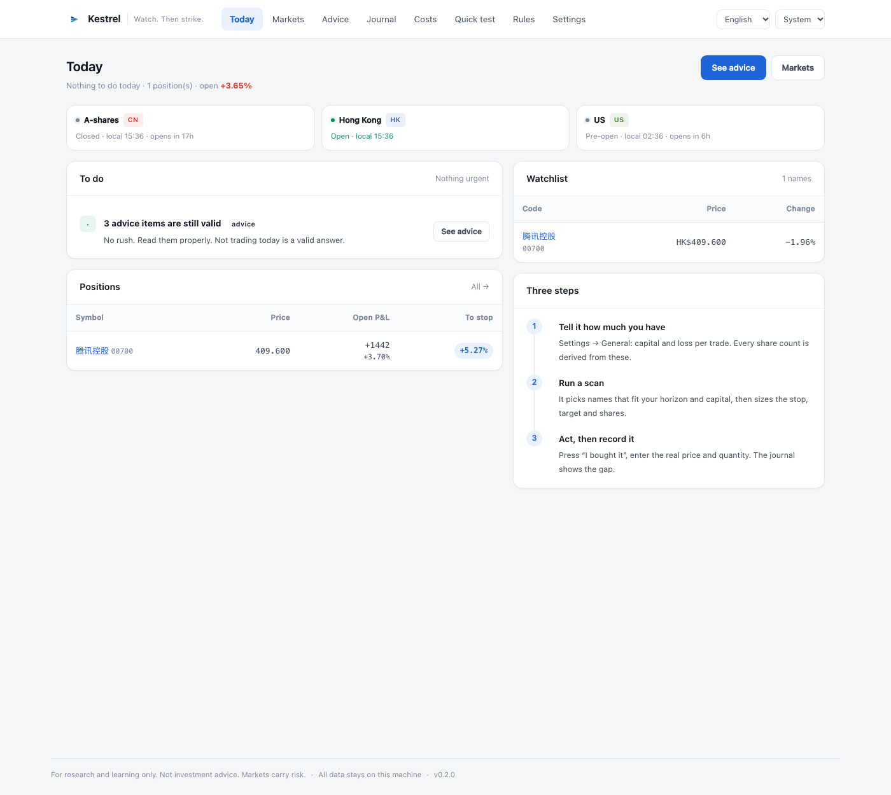
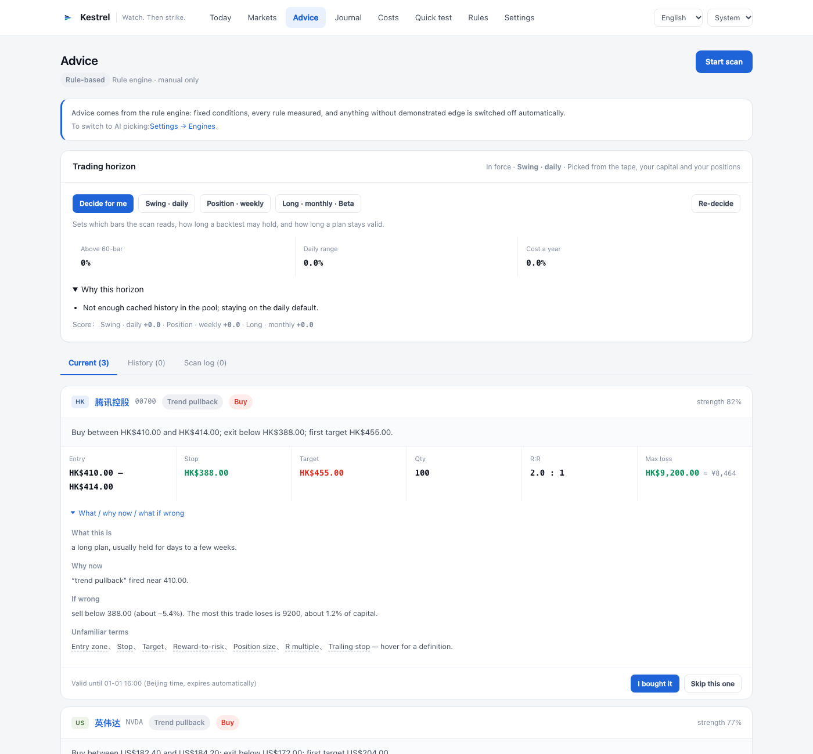
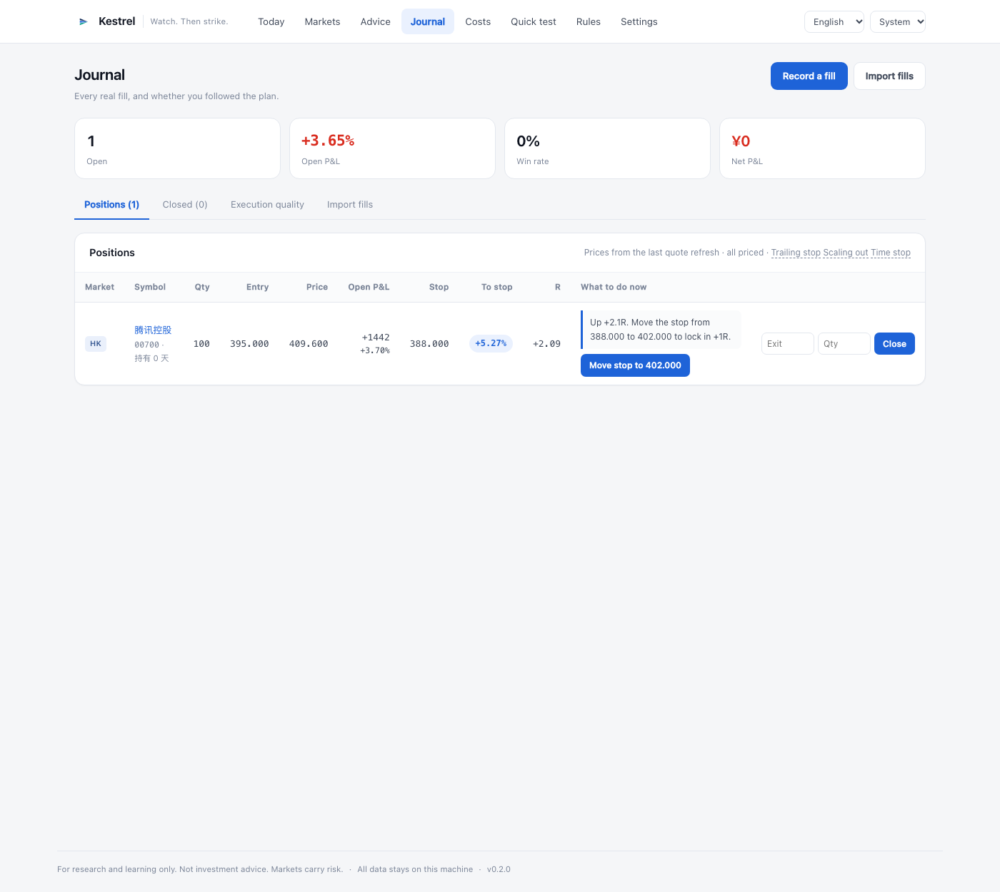

<div align="center">


<h1>Kestrel</h1>

**What to buy today, how much, and when to sell.**

A trading tool that runs on your own machine: it screens A-shares, Hong Kong and US names,
hands you a plan you can place as-is, records the price you *actually* paid, and then manages
the position until it is closed.

<br/>

[](https://github.com/jukkakakaka/kestrel/actions/workflows/ci.yml) [](LICENSE) [](pyproject.toml) [](#install)

[English](README.md) · [简体中文](README.zh-CN.md) · [Docs](docs/) · [Engines](docs/engines.md) · [Architecture](docs/architecture.md)



</div>

---

## Four things it does for you

1. **Pick** — a market-cap-ranked candidate pool per market, indicator by indicator, filtered
   against your horizon and your capital.
2. **Size** — every idea arrives with an entry band, a stop, a target, a share count, fees,
   a break-even price and an expiry. You place it as written.
3. **Manage** — while you hold it, it tells you how far the stop is, whether to raise it, and
   whether to take half off.
4. **Record** — the fill price and quantity are whatever you actually got (**they may differ
   from the plan**), and the gap between plan and reality becomes a number.

Multiple markets and multiple frequencies are the point, not a feature list: A-shares and Hong
Kong trade in lots and charge stamp duty, the US trades single shares; a swing trader and a
position trader need different stop widths, plan lifetimes and time limits. Those settings
change every number the tool produces.

## Three-minute start

**Install** (macOS, Apple Silicon and Intel)

Grab `Kestrel-*.dmg` from [releases](https://github.com/jukkakakaka/kestrel/releases) and drag it
into Applications. The bundle is ad-hoc signed, so clear the quarantine flag once:

```bash
xattr -dr com.apple.quarantine /Applications/Kestrel.app
open /Applications/Kestrel.app
```

**The first run asks three questions**: capital, loss per trade, and which markets you trade.
The last one decides what gets scanned — a market you switch off disappears from every page.

**Then**:

1. *Advice* → *Start scan*.
2. Qualified setups appear as cards: entry band, stop, target, share count, reward-to-risk,
   worst-case loss in money.
3. Place the order in your broker app, then press *I bought it* and enter **the real fill price
   and quantity**.
4. *Today* keeps telling you which position is near its stop, which advice is about to expire,
   and when to sell.

> A rejected setup is information too. The page names the reason — *"one lot already exceeds your
> risk budget"*, *"stop distance of 22% is too wide"* — instead of pretending nothing came up.



## Selling is the main event

You buy once; you sell across the whole life of the trade. The two classic beginner losses live
here: refusing to take a profit, and refusing to admit a mistake. So every open position gets
**one** recommendation, with a price attached:

| Trigger | Action | Why |
|---|---|---|
| Price below the stop | Exit now | The stop is a pre-agreed admission, not a suggestion |
| +1R | Move the stop to **break-even** | Worst case becomes a scratch |
| +2R | Move the stop to **+1R** | Lock one unit, let the rest run |
| First target reached | **Sell at least half** | Trail the rest instead of guessing the top |
| Held past the horizon limit with nothing to show | **Time stop** | Capital and attention have a cost |

A stop may only move up — the app refuses any downward edit, because lowering a stop is the same
as removing it. Every move is logged (when, from, to, why) so a review can tell discipline from
panic.



## Plan → fill → journal, closed end to end

```
scan → advice (entry / stop / target / qty / fees / expiry)
     → you fill at your own price and quantity
     → record the fill (receipt page or journal)
     → position monitor (live price, open P&L, distance to stop, R multiple) + exit advice
     → push alert on stop hit / near stop / target reached
     → close (partial closes allowed) → execution quality: follow rate, drift in R
```

- Advice said buy 100 at 400–404. You got 60 filled at 402.5 — record 60 at 402.5. The journal
  marks it partial, and execution quality counts it as *planned 100 / actual 60*.
- Sells can be partial. Each sell closes the oldest position first (FIFO); the original entry row
  is never rewritten.
- Paid 0.5R above plan and the quality page says so: *"that ate half your stop distance."*
- Not following the plan is recorded too. A low follow rate is a signal, not a sin.

## Markets and frequencies

| Market | What is different | Fee model |
| :--- | :--- | :--- |
| **A-shares** | 100-share lots, T+1, price limits | commission (0.025%, min ¥5) + 0.05% stamp on sells + transfer fee |
| **Hong Kong** | lot size varies per stock (100/500/1000), no price limits | commission + platform fee + **0.1% stamp each side** + four levies |
| **US** | single shares, no stamp duty | per-share platform fee + SEC/TAF on sells |

| Horizon | Bars | Typical hold | Plan lifetime | Stop band |
| :--- | :--- | :--- | :--- | :--- |
| Swing | daily | days to weeks | next session close | 1.5%–15% |
| Position | weekly | weeks to two months | 10 days | 3%–18% |
| Long (Beta) | monthly | months | 45 days | 5%–30% |

On *auto* it weighs pool breadth, median daily range, your capital and your actual fee schedule,
picks one and **explains why**. Pin a horizon at any time and it stops arguing.

## Three engines

Who produces advice is one global switch. The advice page has one button whose label follows it.

| Engine | Decides | Latency | Cost |
| :--- | :--- | :--- | :--- |
| **Rules** | fixed conditions over indicators; rules are JSON you can edit in the UI | instant | free |
| **Model** (OpenAI-compatible) | reads indicators, your account and each rule's measured record | ~30 s | per token |
| **WorkBuddy** | same, over a file queue serviced by a scheduled job | minutes | free |

In both AI modes **risk and sizing stay in local code**: the model's share count is discarded, the
stop must sit inside the current horizon's band, reward must clear 1.5R, the ticker must be in the
candidate list, one sector may not dominate, exposure is capped. Rejected picks are logged with a
reason and shown in the UI.

Model calls have a daily budget. When it runs out the app **says so and stops** — it never quietly
falls back to rules.

## Automatic updates

Settings → About shows the version and a *Check for updates* button. When a release exists it can
download the installer and open it; **the final drag is yours**, because a running app cannot safely
replace itself. On Docker it says to pull the image again instead of pretending otherwise.

Same thing from a terminal:

```bash
kestrel version          # version, platform, data directory, update state
kestrel update --check   # check now
kestrel update --install # download and open the installer
```

## Data sources

| Source | Cost | Markets | Notes |
| :--- | :--- | :--- | :--- |
| Eastmoney | free | CN / HK / US | primary, JSON |
| Tencent · Sina | free | CN / HK / US | GBK fallbacks |
| Yahoo | free, no key | CN / HK / US | used to cross-check the others |
| Finnhub · Alpha Vantage · Twelve Data · Polygon · Tiingo | free tier or paid | per provider | paste a key |

Built-in sources toggle individually; disabling one falls through to the next. You can also define
your own: URL template, JSON field paths, a scale divisor, and a **test** button that shows the
parsed number before you save it.

## Install

**macOS app**

```bash
make package        # dist/Kestrel.app
make package-dmg    # plus dist/Kestrel-*.dmg
```

**From source** (Python 3.11+, [uv](https://docs.astral.sh/uv/))

```bash
uv sync --extra desktop
uv run kestrel init
uv run kestrel desktop     # native window
uv run kestrel serve       # or the browser: http://127.0.0.1:8000
```

**Windows**

GitHub Actions builds a `Kestrel-windows` zip (Windows 10/11, no Python needed) — download it from
the *Build desktop app* workflow artifacts and run `Kestrel.exe`.

**Docker**

```bash
docker compose up          # http://127.0.0.1:8000, data in a named volume
```

**Everything stays on your machine**: SQLite lives in `~/Library/Application Support/Kestrel`
(macOS), `%APPDATA%\Kestrel` (Windows) or `./data` (source). No account, no telemetry.

## Configuration

Everything else lives in the database and is edited in the UI, effective immediately.
Bootstrap values are environment variables:

| Variable | Default | Meaning |
| :--- | :--- | :--- |
| `KESTREL_HOME` | `./data`, or the OS app-data dir when bundled | database, cache, logs, WorkBuddy queue |
| `KESTREL_HOST` | `127.0.0.1` | bind address |
| `KESTREL_PORT` | `8000` | port |
| `KESTREL_DEBUG` | `false` | verbose logging |

When WorkBuddy is used for analysis or notifications, the queue paths depend on how the app runs
(browser, bundled app, container). The settings page generates the cron-job prompts from the current
configuration, so you never have to assemble a path by hand.

## Learning comes second

Learning is the second layer, not a course. It sits next to the numbers:

- **Learning mode** expands every plan into *what this is / why now / what if it goes wrong*,
  in plain language.
- **60 glossary terms** — stop, reward-to-risk, R multiple, trailing stop, scaling out, time stop,
  T+1, price limits — hover for a definition, and suppress the ones you already know.
- **Execution quality** turns "did you follow the plan" and "how many risk units did you overspend"
  into numbers. Over time those matter more than stock picking.
- **Rules page** shows every rule's measured record, including the verdicts that read
  "insufficient sample".

## Honest limits

- **Daily bars only.** No order book, no fund flows, no earnings expectations. On that information
  set the selection edge is close to zero, and the rules page says exactly that: expectancy is
  positive, but almost all of it comes from the 2:1 payoff, not from the entry.
- **The stop and the size do the work.** Against holding the same entry for the same number of days
  with no stop, the excess return of every shipped rule is near zero.
- **The horizon recommendation is a heuristic**, not a model. It can be wrong; pin a horizon and it
  stops arguing.
- **Long-term is Beta.** Monthly bars see price and volume only, and only two of the seven rules
  produce enough trades to judge.
- **No broker API, no automatic orders.** Deliberate: placing an order is irreversible. Every fill
  goes through one `BrokerAdapter` interface, so wiring a real broker later means replacing one
  class — the journal, alerts and statistics stay as they are.
- **"Automatic update" stops at the download.** A running app cannot safely replace itself; the last
  drag is yours.
- **WorkBuddy mode is asynchronous** and its finest schedule is hourly.
- **No OCR.** Pasting text is more accurate, and less likely to misread a digit.

## Project layout

```
src/kestrel/
  app.py            FastAPI app, routes, template filters
  services/         scan / analyst / engine / rules / universe / calendar /
                    execution (fills) / positions (monitor) / exits (sell rules) /
                    today (briefing) / advisor (horizon) / timeframe (bar folding) /
                    updates (version + update) / prompts (WorkBuddy cron prompts)
  strategies/       rule compiler, built-in rule library, AI-facing JSON Schema
  datasources/      provider chain, Eastmoney/Tencent/Sina, resolver, presets, custom
  planning/         position sizing, stop/target placement, fee-aware plans
  fees/             exchange levy model, broker plans
  web/              Jinja templates + static assets
  db/               schema and versioned migrations
packaging/          PyInstaller spec, macOS build script and dmg layout, icons
scripts/            single source for brand assets, icons and the dmg background
```

## Documentation

| Document | Contents |
| :--- | :--- |
| [docs/engines.md](docs/engines.md) | The three engines, shared risk checks, testing rules in AI mode |
| [docs/architecture.md](docs/architecture.md) | Module map, data flow, non-negotiables |
| [docs/fee-model.md](docs/fee-model.md) | Exchange levies and broker plans |
| [docs/notifications.md](docs/notifications.md) | Channels, receipts, position alerts, the two WorkBuddy jobs |
| [docs/ui-map.md](docs/ui-map.md) | Route table and naming rationale |

## Development

```bash
uv sync --extra desktop --extra dev
uv run kestrel init
uv run pytest            # 169 tests
uv run ruff check src tests
uv run uvicorn kestrel.app:app --reload --app-dir src
```

The suite must pass against an **empty data directory**: CI has no pre-seeded database, and
`tests/conftest.py` guarantees a migrated one for every session.

After changing the brand or icons, run `uv run python scripts/make_brand_assets.py`. It regenerates
the web assets, favicons and app icon from the single definition in `scripts/brand.py`;
`scripts/make_dmg_background.py` owns the installer window. They must agree — otherwise users see
four different marks in four places.

## Disclaimer

Kestrel gives no investment advice, forecasts no prices and places no orders. Nothing it produces is
an offer to buy or sell any security. Markets carry risk; the decisions are yours. Its most useful
feature may be telling you that today is not the day.

## License

GPL-3.0 © Kestrel contributors
