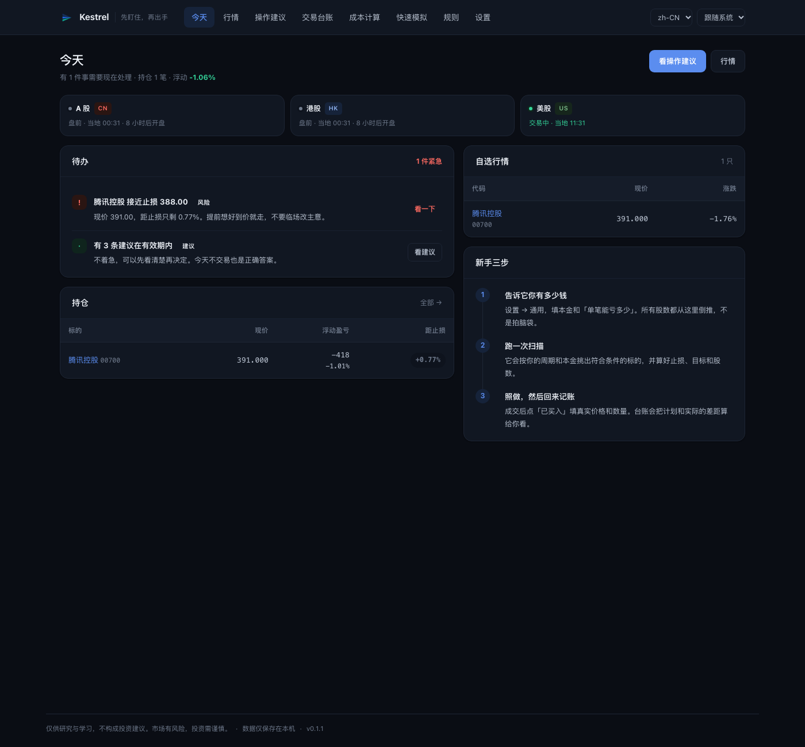
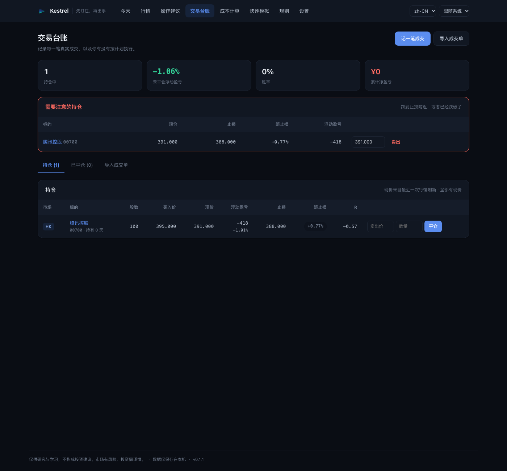

<div align="center">


<h1>Kestrel 隼</h1>

**先盯住，再出手。**

一个装在自己电脑上的炒股助手：告诉你现在该做什么、帮你把仓位和止损算清楚、
记下你真实成交的价格和数量，然后把你和计划的差距摊开给你看。

<br/>

[](https://github.com/jukkakakaka/kestrel/actions/workflows/ci.yml) [](LICENSE) [](pyproject.toml) [](#安装)

[English](README.md) · [简体中文](README.zh-CN.md) · [文档](docs/) · [引擎](docs/engines.md) · [架构](docs/architecture.md)



</div>

---

## 它解决什么问题

新手第一次打开炒股软件，看到的是三百个跳动的数字和一个搜索框。
真正该问的问题其实只有三个：

1. **我现在手里这些要不要动？**
2. **有没有值得买的？买多少、什么价买、什么时候认错？**
3. **我上次到底是怎么做的，和计划差多少？**

Kestrel 就是按这三个问题组织的。首页叫「今天」，只显示待办；
每条建议都带着止损、目标、股数和最坏情况下的亏损金额；
成交之后你回来记一笔真实成交（**价格和数量可以和建议不一样**），
台账会算给你看：买贵了多少、偏离了几个风险单位、有没有按计划卖出。

它的目标不是让你觉得「有 AI 帮我选股」，而是让一个完全不懂的人，
照着做几十次之后**自己看懂**为什么这么定止损、为什么仓位是这么多。

## 三分钟上手

**装好应用**（macOS，Apple Silicon 与 Intel）

从 [releases](https://github.com/jukkakakaka/kestrel/releases) 下载 `Kestrel-*.dmg`，
拖进「应用程序」。安装包是自签名（ad-hoc），第一次打开前需要去掉隔离标记：

```bash
xattr -dr com.apple.quarantine /Applications/Kestrel.app
open /Applications/Kestrel.app
```

**第一次打开会问你三个问题**：有多少钱、最多能亏多少、做哪几个市场。
答案决定后面所有股数和止损的计算方式，不填也能用默认值。

**然后**：

1. 点「操作建议」→「开始扫描」。它会从各市场按市值取候选池，逐只算指标。
2. 有合适的会列出卡片：入场区间、止损、目标、股数、盈亏比、最多亏多少。
3. 你在券商 App 里照着下单，成交后回来点「我已经买了」，**填真实成交价和数量**。
4. 首页「今天」会每天告诉你：哪只跌到止损附近了、哪条建议快过期了、什么时候该卖。

> 建议被拒也是信息。页面会显示「一手就超过你的风险预算」「止损距离 22% 太宽」
> 这类原因，而不是假装没有机会。


## 从计划到台账：一条完整的闭环

```
扫描 → 建议（入场/止损/目标/股数/费用/截止时间）
     → 你按自己的价格和数量成交
     → 回执页或台账记一笔真实成交
     → 持仓监控（现价、浮盈、距止损、R 倍数）
     → 触及止损 / 到达目标 / 接近止损时推送提醒
     → 平仓（可分批）→ 执行质量报告：执行率、平均偏离几个 R
```

这是这个项目和「选股软件」最大的区别：**它记录事实，不美化事实。**

- 建议说 400–404 买 100 股，你 402.5 只买到 60 股，就记 60 股 @ 402.5；
  台账会显示「部分成交」，执行质量里算进「计划 100 / 实际 60」。
- 卖出可以分批。每笔卖出按 FIFO 平掉最早的持仓，原始建仓记录不会被改写。
- 买贵了 0.5R，执行质量页会直说：「等于你的止损距离被吃掉一半」。
- 没按建议做也照实记。执行率低不是道德问题，是信号——说明建议不合你的口味，
  或者你还没准备好照做。



## 支持的市场与频率

| 市场 | 交易规则差异 | 费用模型 |
| :--- | :--- | :--- |
| **A 股** | 100 股一手、T+1、涨跌停 | 佣金（万 2.5，最低 5 元）+ 卖出印花税 0.05% + 过户费 |
| **港股** | 每手股数各不相同（100/500/1000）、无涨跌停 | 佣金 + 平台费 + **买卖双向**印花税 0.1% + 四项征费 |
| **美股** | 可以只买 1 股、无印花税 | 按股平台费 + 卖出侧 SEC/TAF |

**频率**由「交易周期」控制，三档，各自独立：

| 周期 | K 线 | 典型持有 | 计划有效期 | 止损带 |
| :--- | :--- | :--- | :--- | :--- |
| 短线 | 日线 | 几天到几周 | 下一个交易日收盘 | 1.5%–15% |
| 中线 | 周线 | 几周到两个月 | 10 天 | 3%–18% |
| 长线（Beta） | 月线 | 几个月 | 45 天 | 5%–30% |

不设置时选「自动」：它会看候选池广度、日均波动、你的本金和实际费率，
给出一档并**说明理由**（比如「本金 5 万偏小，交易成本占比高，减少换手比抓时点更重要」）。
每次扫描都可以被推翻，也随时可以手动固定。

## 三个引擎

谁产生建议是一个全局开关。操作建议页只有一个按钮，按钮文字跟着它变。

| 引擎 | 谁做决定 | 速度 | 成本 |
| :--- | :--- | :--- | :--- |
| **规则** | 固定条件比较指标，规则是 JSON 数据，可在页面里改 | 即时 | 免费 |
| **大模型**（OpenAI 兼容） | 读候选股指标、你的账户、每条规则的实测结果后自己选 | 约 30 秒 | 按 token |
| **WorkBuddy** | 同上，但走文件队列，由定时任务处理 | 分钟级 | 免费 |

两种 AI 模式下，**风控和仓位始终由本地代码强制**：模型给的股数一律不采纳，
止损必须落在当前周期的止损带内，盈亏比至少 1.5，代码必须在候选列表里，
同一行业不能扎堆，总仓位不能超上限。被拒绝的建议带原因入库并显示在页面上。

模型调用有每日次数上限，用完就**明确报错**，不会偷偷退回规则引擎——
否则你以为在用 AI，其实在用规则。

## 规则必须证明自己

内置规则不是拍脑袋写死的。每条规则都跑三折滚动验证，基准是
「同样的入场点、同样的持有天数、不设止损」——打不过拿着不动就没资格当建议。

在约 100 只候选股、25 年的日线数据上（按周线 / 月线折叠后重跑）的真实结果是：

| 周期 | 结论 |
| :--- | :--- |
| 日线 | 5 条「无优势」、1 条「不稳定」；规则的期望大多来自 2:1 赔率，而不是入场点 |
| 周线 | 2 条「不稳定」、3 条「无优势」 |
| 月线 | 只有「趋势回踩」（96 笔）与「超跌长下影」（42 笔）样本够判断，其余显示「样本不足」 |

同一套规则在三个周期上给出三种答案，所以判定按周期分别存档：
某条规则在日线亏钱，只会在日线被停用，不会整体下线。
**这个工具的价值在于纪律和成本，不在于预测。** 规则页会把上面的数字逐条摊开给你看，
包括「样本不足」这种不好看但必须说出来的结论。

## 数据来源

| 来源 | 费用 | 市场 | 说明 |
| :--- | :--- | :--- | :--- |
| 东方财富 | 免费 | A 股 / 港股 / 美股 | 主源，JSON、字段最全 |
| 腾讯 · 新浪 | 免费 | A 股 / 港股 / 美股 | GBK 编码的备用源 |
| Yahoo | 免费，无需 key | A 股 / 港股 / 美股 | 用来交叉验证 |
| Finnhub · Alpha Vantage · Twelve Data · Polygon · Tiingo | 免费额度或付费 | 按供应商 | 粘贴 API Key 即可 |

内置源可以单独开关，关掉一个会自动落到下一个。也可以自己定义一个数据源：
URL 模板、JSON 字段路径、换算系数，还有「先测一下」按钮，保存前就能看到解析出来的数字。

## 安装方式

**macOS 应用**（上文的 dmg，或者自己构建）

```bash
make package        # dist/Kestrel.app
make package-dmg    # 额外生成 dist/Kestrel-*.dmg
```

**从源码运行**（Python 3.11+，需要 [uv](https://docs.astral.sh/uv/)）

```bash
uv sync --extra desktop
uv run kestrel init
uv run kestrel desktop     # 原生窗口
uv run kestrel serve       # 或者浏览器：http://127.0.0.1:8000
```

**Windows**

GitHub Actions 会构建 `Kestrel-windows` 压缩包（Windows 10/11，无需安装 Python），
在对应 workflow 的 Artifacts 里下载，解压后运行 `Kestrel.exe`。

**Docker**

```bash
docker compose up          # http://127.0.0.1:8000，数据存在命名卷里
```

**所有数据都在本机**：SQLite 文件在 `~/Library/Application Support/Kestrel`（macOS）、
`%APPDATA%\Kestrel`（Windows）或 `./data`（源码运行）。没有账号，没有遥测，不上传任何东西。

## 配置

其余设置都在界面里改，立即生效。启动参数用环境变量：

| 变量 | 默认值 | 含义 |
| :--- | :--- | :--- |
| `KESTREL_HOME` | `./data`，打包版是系统应用数据目录 | 数据库、缓存、日志、文件队列 |
| `KESTREL_HOST` | `127.0.0.1` | 监听地址 |
| `KESTREL_PORT` | `8000` | 端口 |
| `KESTREL_DEBUG` | `false` | 详细日志 |

## 诚实的局限

这一节大多数 README 会跳过。

- **只有日线级数据。** 没有盘口、没有资金流、没有盈利预期。在这个信息集上，选股的边际优势接近零，
  规则页会把这件事实话实说：期望是正的，但几乎全部来自 2:1 的赔率结构，而不是入场点的选择。
- **真正干活的是止损和仓位。** 和「同样入场、不设止损持有同样天数」相比，内置规则超额收益接近零。
  把它当成纪律与成本工具，而不是预言机。
- **周期推荐是启发式规则**，由广度、波动、本金、费率加权而成，会错。固定你想要的周期后它就不再争论。
- **长线是 Beta。** 月线只有价和量，样本最少（100 只、约 25 年历史里，只有两条规则交易数够判断）。
- **不接券商 API，不会自动下单。** 这是刻意的：下单是不可撤销的操作，当前版本只做记录与提醒。
  所有成交都经过同一个 `BrokerAdapter` 接口，将来接入只需要替换一个类，台账、提醒、统计都不用改。
- **WorkBuddy 模式是异步的**，最快一小时一轮。
- **不做 OCR。** 粘贴文字比识别图片更准，也更不容易把数字读错。

## 项目结构

```
src/kestrel/
  app.py            FastAPI 应用、路由、模板过滤器
  services/         scan / analyst / engine / rules / universe / calendar /
                    execution（成交）/ positions（盯盘）/ today（待办）/
                    advisor（周期推荐）/ timeframe（K 线折叠）
  strategies/       规则编译器、内置规则库、给 AI 的 JSON Schema
  datasources/      数据源链、东财/腾讯/新浪、解析器、自定义源
  planning/         仓位计算、止盈止损、含费计划
  fees/             交易所征费模型、券商套餐
  web/              Jinja 模板与静态资源
  db/               表结构与版本化迁移
packaging/          PyInstaller spec、macOS 构建脚本、图标
```

## 文档

| 文档 | 内容 |
| :--- | :--- |
| [docs/engines.md](docs/engines.md) | 三个引擎、共用风控、AI 模式下每个页面的角色 |
| [docs/architecture.md](docs/architecture.md) | 模块地图、数据流、存储 |
| [docs/fee-model.md](docs/fee-model.md) | 交易所征费与券商套餐 |
| [docs/notifications.md](docs/notifications.md) | 推送渠道、回执、签名方案 |
| [docs/ui-map.md](docs/ui-map.md) | 路由表与命名理由 |

## 开发

```bash
uv sync --extra desktop --extra dev
uv run kestrel init
uv run pytest            # 133 个测试
uv run ruff check src tests
uv run uvicorn kestrel.app:app --reload --app-dir src
```

测试在**空数据目录**下必须全部通过：CI 上没有预置数据库，
早期版本有过「本地绿、CI 红」的教训，现在由 `tests/conftest.py` 保证每个会话都有干净的库。

## 免责声明

Kestrel 是研究与学习工具。它**不提供投资建议、不预测价格、不下单**。
它产出的任何内容都不构成买卖任何证券的要约。市场有风险，决定权在你。
它最有用的功能，可能是告诉你今天不该动手。

## 许可证

Apache-2.0 © Kestrel contributors
