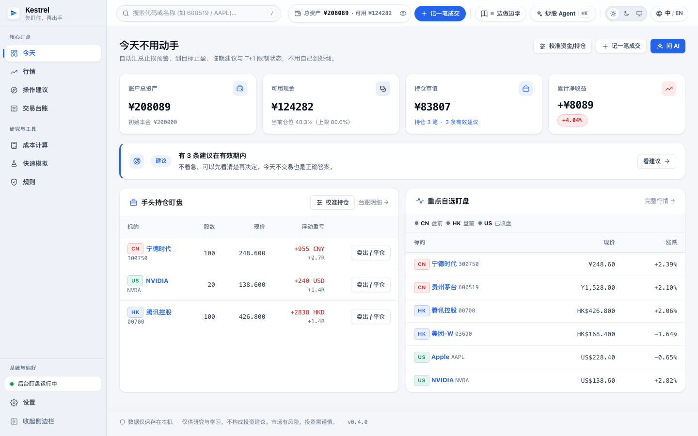
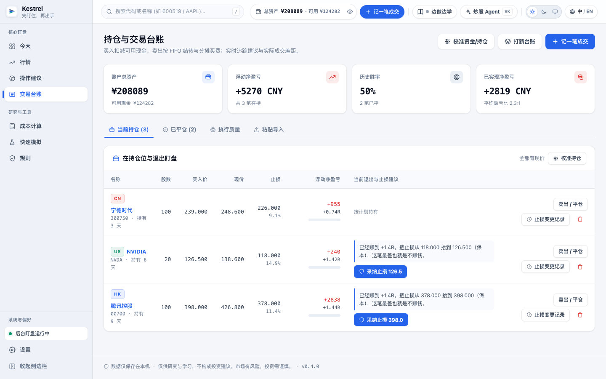
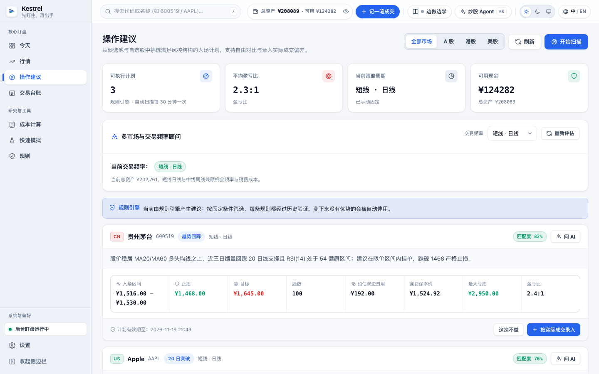
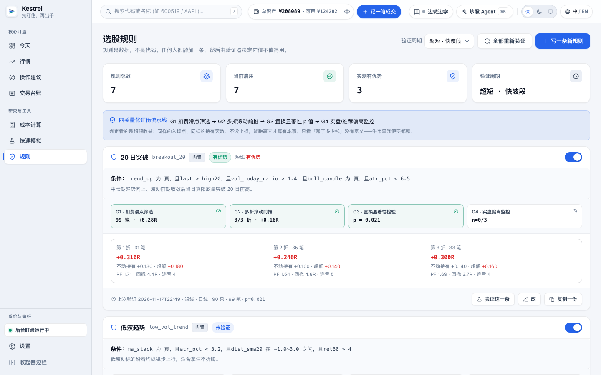
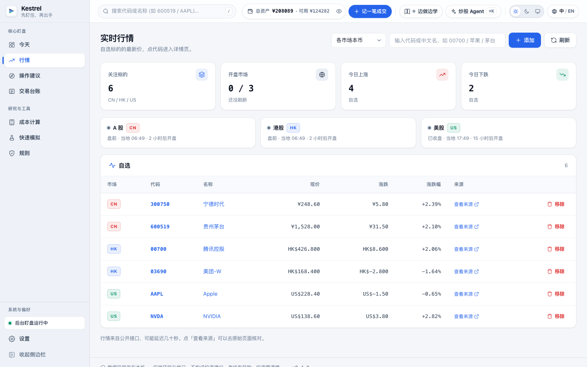
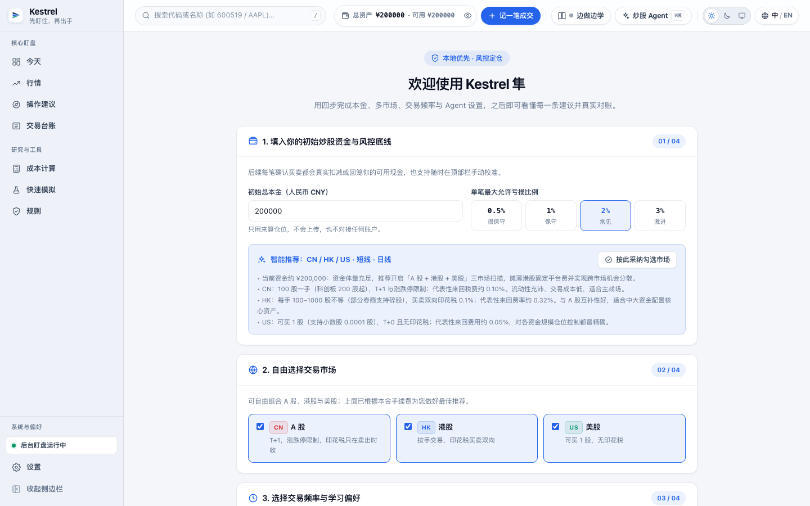

<div align="center">


<h1>Kestrel 隼</h1>

**今天买什么，买多少，什么时候卖。**

一个装在自己电脑上的专业炒股与风控工作台：扫描 A 股 / 港股 / 美股，经四关量化证伪检验策略成色，给出可以直接照着下单的含费计划，记下真实成交价量，并在系统托盘驻留后台替你把持仓盯到卖出为止。

<br/>

[](https://github.com/jukkakakaka/kestrel/actions/workflows/ci.yml) [](LICENSE) [](pyproject.toml) [](#安装方式)

[English](README.md) · [简体中文](README.zh-CN.md) · [文档](docs/) · [引擎与证伪](docs/engines.md) · [架构](docs/architecture.md) · [工作台地图](docs/ui-map.md)



</div>

---

## 第一次使用

1. 从 [GitHub Releases](https://github.com/jukkakakaka/kestrel/releases/latest) 下载桌面客户端。第一次启动，填写以人民币计的账户本金，选择 A 股、港股和美股中的一个或多个市场，再选交易周期。保留推荐时，市场覆盖从本金和典型下单门槛出发，周期会结合所选市场的费用与近期行情。样本不足时会说明。
2. 在「操作建议」点「开始扫描」。有计划时，先核对标的、建议股数、入场区间、止损、目标、预估费用和有效期。行情落后于最近一个已收盘交易日时，扫描会跳过该标的并显示原因。没有合适计划时，可以继续观察。
3. 在自己的券商 App 搜索同一标的。核对市场、币种和数量，选择买入限价单。余额、价格或券商规则不符合计划时，可以跳过。确认券商已经成交后，再回 Kestrel 点「按实际成交录入」。
4. 按券商成交单录入**实际价格和股数**。例如计划 400–404 买 100 股，第一次只成交 60 股 @ 402.50，就录入这一笔。后续成交用「补记实际成交」，建议卡会累计股数和加权均价。可填写实际费用和成交日期，留空分别使用预估费用和录入时间。计划到期后仍可从历史补录真实成交。
5. 在「今天」和「交易台账」查看现金、持仓和风险提醒。卖出仍在券商完成。回台账登记时，可以指定某笔持仓，或由 Kestrel 按买入时间先后匹配可卖批次。

「边做边学」默认关闭。打开后，建议卡解释限价、股数和止损，「快速模拟」提供无需行情或账户的练习题。术语提示可单独关闭。需要 AI Copilot 时可配置自己的模型接口。

| 建议卡字段 | 如何使用 |
| :--- | :--- |
| 入场区间、建议股数 | 与券商可用现金、市场、币种和手数规则核对后，再填写限价单 |
| 止损、目标 | 作为离场计划。跳空、停牌、交易制度和流动性都可能让实际成交偏离这两个价格 |
| 预估双边费用、含费保本价 | 判断价差能否覆盖买入和卖出费用，实际费用以券商成交单为准 |
| 单笔风险和盈亏比 | 比较按计划离场时的估算风险及潜在收益。它们会随实际成交价和股数变化 |

## 卖出才是重头戏

买入只有一次，卖出贯穿整笔交易。持仓页对每一笔在持股票只给**唯一一个**当前动作建议，带具体价位：

| 触发条件 | 动作建议 | 为什么 |
|---|---|---|
| 现价跌破止损 | 立刻离场 | 止损是提前定好的认错价，不是参考价 |
| 涨到 +1R | 止损抬到**含费保本价** | 估算触发价覆盖往返成本，成交仍取决于行情 |
| 涨到 +2R | 止损抬到 **+1R** | 先锁定一档利润，剩下的让趋势跑 |
| 到达第一目标 T1 | **按整手先卖一半** | 剩余仓位用移动止损跟随，不猜顶 |
| 超过该周期持仓上限仍无起色 | **时间止损** | 资金占用与注意力本身就是机会成本 |

止损只能往上抬，程序会拒绝任何下移操作——往下调止损等于取消止损。每一次上移都记录在案（时间、原止损、新止损、原因）。



## 计划 → 成交 → 台账 → 证伪，完整闭环

```
扫描 → 建议（入场区间 / 止损 / 目标 / 股数 / 双边费用 / 含费保本价 / 有效期）
     → 你在券商 App 成交后录入实际价格与股数（实时预演滑点偏差）
     → 动态资金账本自动扣减/回笼现金，持仓监控现价、浮盈与 R 倍数
     → 系统托盘常驻后台盯盘，触发止损 / 近止损 / 到目标推送提醒
     → 分批或全额 FIFO 平仓 → 执行质量统计 + What-if 盈亏归因 + 规则 G4 实盘偏离监控
```



## 四关量化证伪：先证伪策略，再谈信号

大多数工具只给你看精挑细选的回测曲线；Kestrel 把「检验策略是不是随机运气或参数过拟合」做成一等公民（详见 `/sim` 与 `/rules`）：

1. **G1 扣费滑点筛选（次日开盘防前视）**：所有指标严格在历史前缀上计算，第 `i` 根收盘出信号后按第 `i+1` 根**开盘价叠加滑点**（默认 `10 bps`）成交，并扣除双边手续费（默认 `20 bps`），过滤样本不足或扣费后负期望的规则。
2. **G2 多折滚动前推（Walk-Forward）**：分段历史回放，对比同期同入场无脑持有的超额收益与正收益折占比。
3. **G3 500 次固定种子置换检验 & `3×3` 参数高原热力图**：以 `seed=42` 执行 500 次蒙特卡洛置换计算 `p` 值——若前推盈利但 `p ≥ 0.10`，系统**强制将规则从「有优势」降级为「不稳定」**；`/sim` 同步绘制持仓周期 × ATR 止损倍数的 `3×3` 邻域热力矩阵，一眼分辨「稳健高原」与「孤立过拟合尖刺」。
4. **G4 实盘表现偏离预警（Live Drift）**：持续对比该规则在历史推荐与你真实平仓记录中的平均 R 与回测期望，显著跑输时自动亮起偏离预警横幅。



## 支持的市场与五档频率

| 市场 | 真实交易制度支持 | 费用模型 |
| :--- | :--- | :--- |
| **A 股（CN）** | 主板 100 股整手、科创板/北交所 `200 股起 + 1 股递增`、`T+1` 卖出锁定、涨跌停限制 | 佣金（万 2.5，最低 5 元）+ 卖出印花税 0.05% + 过户费 |
| **港股（HK）** | 每手股数因股而异（100/500/1000 等）、无涨跌停；券商套餐支持不足一手的碎股 | 佣金 + 平台费 + **买卖双向**印花税 0.1% + 四项规费 |
| **美股（US）** | 单股起买，支持 `0.0001` 小数股与最低金额门槛；无印花税 | 按股平台费 + 卖出侧 SEC / TAF 规费 |

行情页支持「各市场本币」或一键统一折算为人民币 / 港币 / 美元。



| 周期档位 | K 线粒度 | 典型持有 | 计划有效期 | 合法止损带 |
| :--- | :--- | :--- | :--- | :--- |
| 快进快出（`fast`） | 日线 | 最长 5 根日线 | 下一个交易日收盘 | 1.2%–8% |
| 短线（`short`） | 日线 | 几天到两周 | 下一个交易日收盘 | 1.5%–15% |
| 中线（`medium`） | 周线 | 几周到两个月 | 10 天 | 3%–18% |
| 长线（`long` · Beta） | 月线 | 数月 | 45 天 | 5%–30% |

选择「智能顾问（`auto`）」时，系统综合候选池广度、波动率、你的本金与券商实际费率给出推荐档位及理由。手动选择后按该周期运行。扫描间隔在设置中单独调整。

## 三个选股引擎与硬风控

| 引擎 | 谁做选股决策 | 速度 | 成本 |
| :--- | :--- | :--- | :--- |
| **规则引擎** | JSON 声明式条件比较技术指标，可在 `/rules` 编辑与验证 | 即时 | 免费 |
| **大模型**（OpenAI 兼容） | 读取候选池指标、账户约束与各规则四关证伪结论后综合挑选 | 约 30 秒 | 按 Token |
| **WorkBuddy** | 同上，通过本地文件队列交由外部定时任务异步消费 | 分钟级 | 免费 |

在两种 AI 模式下，**仓位计算与硬风控始终由本地代码强制接管**：模型给出的股数一律丢弃，止损必须落在当前周期止损带内，净盈亏比至少 `1.5`，代码必须在候选白名单内，单一行业与总敞口严格受控。模型调用受每日预算上限保护，耗尽即明确报错，绝不偷偷退回规则引擎。

## 安装方式与桌面后台常驻

**macOS 桌面客户端**（macOS 11+，Apple Silicon 与 Intel）

从 [Releases](https://github.com/jukkakakaka/kestrel/releases) 下载 `Kestrel-*.dmg`，拖入「应用程序」。安装包采用自签名（ad-hoc），首次打开前清除隔离标记即可：

```bash
xattr -dr com.apple.quarantine /Applications/Kestrel.app
open /Applications/Kestrel.app
```

- **菜单栏托盘与后台常驻**：启动后右上角菜单栏会出现 Kestrel 品牌图标（含打开主窗口、在浏览器打开、后台盯盘状态、立即扫描、切换金额隐私打码、关闭窗口时驻留后台、退出 Kestrel 共 7 项菜单）。默认点击窗口左上角关闭按钮只会隐藏主窗口驻留后台盯盘，点击菜单栏图标或 Dock 图标即可瞬间唤醒。
- **从源码自行打包**：
  ```bash
  make package        # 构建 dist/Kestrel.app（使用独立 .build-venv，不污染开发环境）
  make package-dmg    # 构建 dist/Kestrel.app + dist/Kestrel-0.4.0.dmg 并执行内置冒烟测试
  ```

**从源码运行**（Python 3.11+，推荐使用 [uv](https://docs.astral.sh/uv/)）

```bash
uv sync --extra desktop
uv run kestrel init
uv run kestrel desktop               # 启动 1360×860 原生桌面窗口 + 系统托盘
uv run kestrel desktop --minimized   # 初始隐藏主窗口，静默驻留系统托盘后台盯盘
uv run kestrel serve                 # 纯本地 Web 服务：http://127.0.0.1:8000
```

**Windows & Docker**

- **Windows**：在 GitHub Actions *Build desktop app* 工作流 Artifacts 下载 `Kestrel-windows.zip`（Windows 10/11 免装 Python），解压运行 `Kestrel.exe`（支持系统托盘与开机自启）。
- **Docker**：`docker compose up`（监听 `http://127.0.0.1:8000`，数据持久化于命名卷）。

**100% 本地数据主权**：SQLite 微单位账本保存在 `~/Library/Application Support/Kestrel`（macOS）、`%APPDATA%\Kestrel`（Windows）或 `./data`（源码运行）。无云端账号，无遥测上报。

## 环境变量配置

绝大部分参数在界面「设置」页修改后即时生效；底层启动行为可通过环境变量控制：

| 变量 | 默认值 | 含义 |
| :--- | :--- | :--- |
| `KESTREL_HOME` | `./data`（打包版为系统应用数据目录） | SQLite 数据库、行情缓存、日志与 WorkBuddy 队列目录 |
| `KESTREL_HOST` | `127.0.0.1` | 本地服务监听地址 |
| `KESTREL_PORT` | `8000` | 本地服务端口 |
| `KESTREL_TRAY` | 自动探测（设为 `0` 禁用） | 控制是否启用系统托盘（无头测试与打包冒烟时设为 `0`） |
| `KESTREL_AUTOSTART_DIR` | 系统用户级启动项目录 | 覆盖开机自启配置写入目录（用于隔离测试） |
| `KESTREL_DEBUG` | `false` | 输出详细调试日志 |

## 全站随时学股票（可选，关掉即零打扰）

- **75+ 交易术语自然悬停释义**：覆盖下单（限价单、滑点、含费保本价）、风控（止损、移动止损、R 倍数、资金校准）、制度（`T+1`、科创板 `200+1`、整手、碎股、印花税）、指标（ATR、RSI、MA20、VCP）与证伪复盘（置换检验、参数高原、What-if 归因）。开启顶栏「边做边学」后自然标出柔和虚线，悬停/点击即可查词、追问 AI 或标记「已学会不再标出」；关闭开关后全站零下划线、零教学横幅。
- **快捷键一览**：`/` 聚焦顶部股票搜索 · `Alt+P` 切换金额隐私打码 · `⌘K`（或 `Ctrl+K`）开关右侧炒股 Agent 抽屉 · `Esc` 关闭弹窗或窄屏导航抽屉。



## 数据和模型的局限

- **基于日线级公开数据**：不含 Level-2 盘口、主力资金流或财报一致预期。规则页的四关证伪会如实展示：纯量价选股的超额边际很薄，长期生存主要依靠严格止损、仓位控制与 `≥ 1.5R` 的非对称赔率。
- **不代客自动下单**：所有交易计划通过 `OrderIntent` / `BrokerAdapter` 准实盘契约生成，但最终下单动作由你在券商 App 亲自确认执行。
- **自动更新到下载打开为止**：`kestrel update --install` 或设置页检查更新会下载最新安装包并打开，最后一步拖拽覆盖由你亲自确认。
- **长线（月线）标为 Beta**：月线周期跨度长、有效信号样本较少，系统对样本不足 `< 12` 笔的规则明确提示「样本不足」而不强下结论。

回测指纹覆盖整段 OHLCV 输入、参数和成交结果，便于识别同名实验的数据变动。验证仍依赖当前候选池和公开行情。数据源可能调整历史价格，市场日历可能没有临时休市或提前收盘信息。回测成交模型采用开盘价和滑点假设，挂单排队、停牌、涨跌停和券商账户限制由真实成交决定。

## 项目结构

```
src/kestrel/
  app.py            FastAPI 路由、SSR 隐私/双语/桌面状态上下文、OHLC K 线几何与模板过滤器
  cli.py            命令行入口（init / serve / desktop [--minimized] / scan / update / version）
  desktop/          app.py（原生窗口与关闭驻留）、tray.py（macOS NSStatusItem + pystray 托盘）、
                    autostart.py（macOS LaunchAgents / Windows Startup / Linux XDG 开机自启）
  services/         portfolio（动态资金账本与手动校准）/ execution（准实盘契约、T+1、FIFO、What-if 归因）/
                    backtest（防前视次日开盘、费率滑点、500 次置换检验、3×3 参数高原热力矩阵）/
                    rules（G1–G4 四关量化证伪与实盘偏离监控）/ copilot（右侧炒股 Agent 与双层守卫）/
                    advisor（多市场与频率推荐）/ timeframe / scan / analyst / exits / positions /
                    journal / statement / today / glossary（75+ 术语）/ config / updates
  core/             money.py（微单位整型与 Tick 对齐）、quantity.py（100 股 / 科创板 200+1 / 碎股 / 小数股）
  indicators/       Wilder RSI / ATR、均线斜率、时段折算量比、VCP 收缩率
  strategies/       声明式 JSON 规则编译器、7 条内置策略库、AI JSON Schema
  datasources/      东财 / 腾讯 / 新浪 / Yahoo / 自定义源熔断降级链与代码解析
  planning/         计入可用现金、双边规费与券商碎股能力的仓位规划器
  fees/             三市场交易所征费模型与可编辑券商套餐
  web/              base.html 三栏自适应工作台、_page_icons.html 线性 SVG 图标库、12 个业务页面与原生 JS
  db/               SQLite WAL 连接事务守卫与 0001–0013 版本化迁移
packaging/          PyInstaller kestrel.spec、macOS .app / .dmg 构建脚本与深浅色 Asset Catalog
scripts/            check.sh 一键门禁、check_locales.py 双语校验、1440×900 自动截图与品牌资产生成
```

## 文档索引

| 文档 | 内容说明 |
| :--- | :--- |
| [docs/architecture.md](docs/architecture.md) | 系统分层、系统托盘常驻架构、三栏隐私契约与防前视铁律 |
| [开源项目对照与审查](docs/review.md) | LEAN、Freqtrade、Qlib 与 Portfolio Performance 的设计参考和剩余限制 |
| [docs/ui-map.md](docs/ui-map.md) | v0.4.0 三栏工作台布局、全量路由表与 `data-privacy` 遮罩规范 |
| [docs/engines.md](docs/engines.md) | 规则 / 大模型 / WorkBuddy 三引擎、硬风控与 G1–G4 四关量化证伪详解 |
| [docs/fee-model.md](docs/fee-model.md) | A 股 / 港股 / 美股交易所规费明细与券商套餐配置 |
| [docs/notifications.md](docs/notifications.md) | 推送渠道、手机签名回执闭环、持仓提醒与 WorkBuddy 定时任务 |

## 开发与校验

```bash
uv sync --extra desktop --extra dev
uv run kestrel init
bash scripts/check.sh    # ruff check (src/tests/scripts) + 1098 keys 双语对齐 + 全量 pytest
uv run uvicorn kestrel.app:app --reload --app-dir src
```

## 免责声明

Kestrel 不提供投资建议、不预测股价、不代客自动下单。软件产出的任何信息均不构成买卖任何证券的要约或承诺。市场有风险，决策与盈亏责任完全在你自己。它最有用的时刻，往往是坦诚地告诉你今天不该动手。

## 许可证

GPL-3.0 © Kestrel contributors
