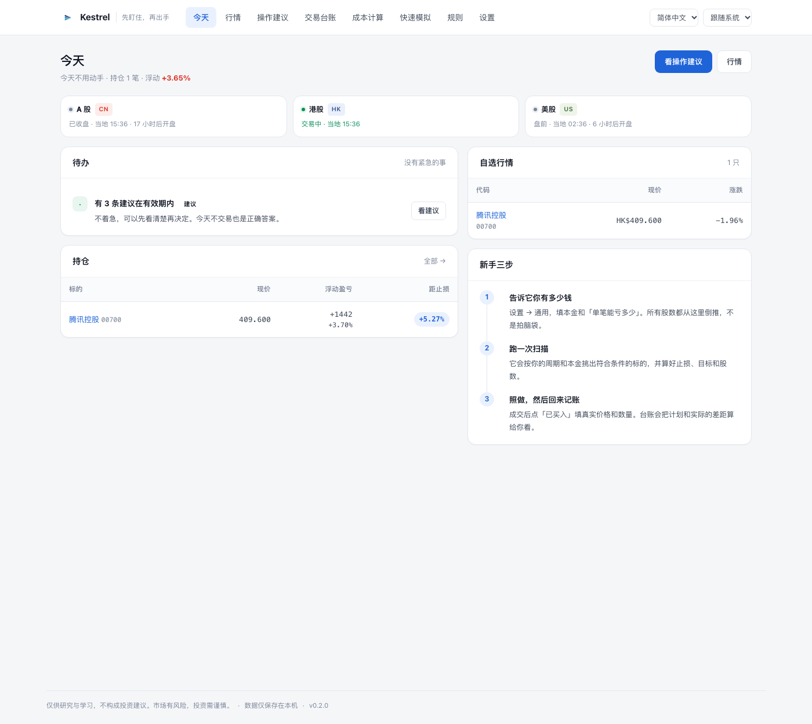
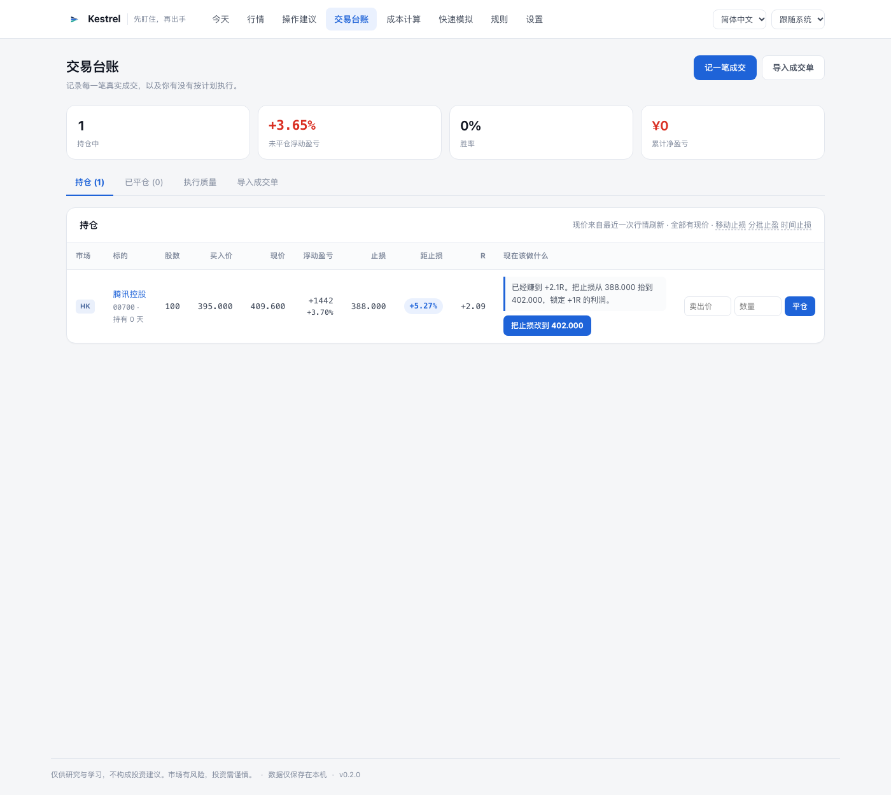
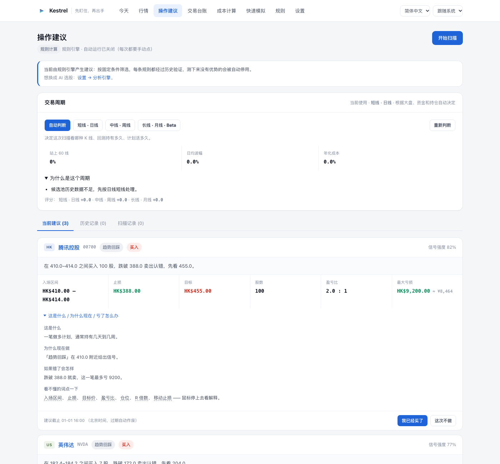
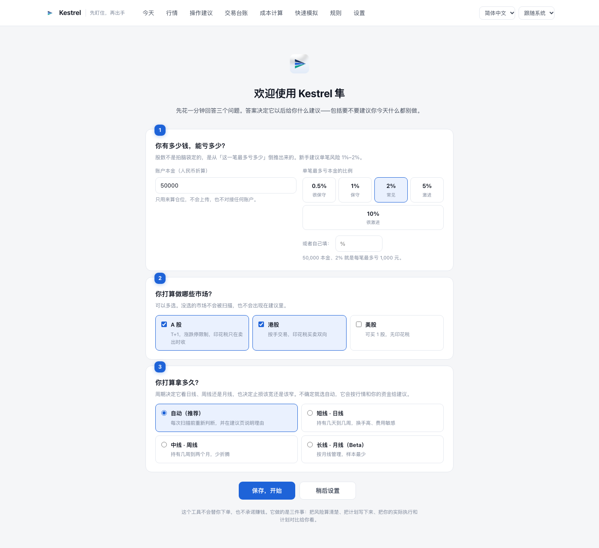

<div align="center">


<h1>Kestrel 隼</h1>

**今天买什么，买多少，什么时候卖。**

一个装在自己电脑上的炒股工具：扫描 A 股 / 港股 / 美股，给出可以直接照着下单的计划，
成交后记下真实价格和数量，然后替你把持仓管到卖出为止。

<br/>

[](https://github.com/jukkakakaka/kestrel/actions/workflows/ci.yml) [](LICENSE) [](pyproject.toml) [](#安装)

[English](README.md) · [简体中文](README.zh-CN.md) · [文档](docs/) · [引擎](docs/engines.md) · [架构](docs/architecture.md)



</div>

---

## 它替你做四件事

1. **选** —— 按市值从每个市场取候选池，逐只算指标，挑出符合你周期和资金条件的标的。
2. **算** —— 每一笔都给出入场区间、止损、目标、股数、费用、保本价和有效期，照着下单就行。
3. **管** —— 持仓期间每天告诉你：离止损还有多远、该不该把止损上移、该不该先卖一半。
4. **记** —— 成交价和数量按你的实际成交记（**可以和建议不一样**），最后把计划和实际的差距算给你看。

多市场、多频率是出发点：A 股和港股按手交易、有印花税，美股能买 1 股；
做几天的人和做几个月的人，止损带宽、计划有效期、多久该放弃，全都不同。
这些不是标签，而是真的会改变它给出的每一个数字。

## 完全没买过股票？从这里开始

不用先学理论。打开应用，照着下面四步做一遍，你就同时完成了一笔交易的完整流程。

**第 1 步：告诉它你有多少钱**（1 分钟）

第一次打开会问三个问题：本金、单笔最多亏多少、做哪几个市场。

- **本金**：只用来算仓位。填一个你真能承受亏损的数字。
- **单笔亏损**：默认 2%。意思是 5 万本金，一笔最多亏 1000 元。新手建议 1%–2%。
- **市场**：没开的市场会从所有页面消失，不会打扰你。

> 为什么先问这个？股数不是拍脑袋决定的。它由「这一笔最多亏多少」倒推：
> `能亏的钱 ÷ 每股止损距离 = 能买几股`。顺序反过来（先想买多少股）是新手最常见的亏法。

**第 2 步：跑一次扫描**（10 秒）

点「操作建议」→「开始扫描」。它会逐只看候选股，满足条件的列成卡片：

| 卡片上的数字 | 意思 |
| :--- | :--- |
| 入场区间 | 在这个价格区间里买都算按计划执行，不用等最低点 |
| 止损 | 认错价。跌破就卖，不是等它涨回来 |
| 目标 | 计划获利了结的位置 |
| 股数 | 按你的本金和风险算出来的，不是它推荐的「重仓」 |
| 盈亏比 | 赚的空间是亏的空间的几倍。低于 1.5 倍的计划会被拒 |
| 最大亏损 | 这一笔最坏会亏掉多少钱 |

没有合适的标的时，它会**明确告诉你今天不用做**，并说明为什么（门槛没到 / 一手就超预算 / 止损距离太宽）。
「不交易」也是一个结论。

**第 3 步：在券商 App 里下单，然后回来记一笔**

成交后点「我已经买了」，填**真实成交价和数量**。
建议说 400–404 买 100 股，你 402.5 只买到 60 股，就记 60 股 @ 402.5——台账照实记，不会替你美化。

**第 4 步：每天打开「今天」看一眼**

首页只放待办：

- 哪只跌到止损附近 → **该卖了**
- 哪只涨到 +1R → **把止损抬到保本**
- 哪条建议快过期 → 想买就趁现在
- 什么都没有 → **今天不用动手**

## 卖出才是重头戏

买入只有一次，卖出贯穿整笔交易。新手最常见的两种亏法都在这里：
涨了不肯走、跌了不肯认。所以持仓页对每一笔只给**一个**建议，带具体价位：

| 触发 | 建议 | 为什么 |
|---|---|---|
| 现价跌破止损 | 立刻离场 | 止损是提前定好的认错价，不是参考价 |
| 涨到 +1R | 止损抬到**保本** | 这笔最差也就是不赚钱 |
| 涨到 +2R | 止损抬到 **+1R** | 锁定一档利润，剩下的让它跑 |
| 到达目标 T1 | **先卖一半** | 剩下用移动止损跟，不猜顶 |
| 超过该周期持仓上限还没走出来 | **时间止损** | 占着资金和注意力本身就是成本 |

止损只能往上抬，程序会拒绝任何下移——往下调止损等于取消止损。
每一次上移都记录在案（时间、从哪到哪、为什么），复盘时能看出当时是纪律还是心虚。



## 计划 → 成交 → 台账，闭环

```
扫描 → 建议（入场/止损/目标/股数/费用/有效期）
     → 你按自己的价格和数量成交
     → 回执页或台账记一笔真实成交
     → 持仓监控（现价、浮盈、距止损、R 倍数）+ 退出建议
     → 止损 / 接近止损 / 到达目标 推送提醒
     → 平仓（可分批）→ 执行质量：执行率、平均偏离几个 R
```

- 卖出可以分批。每笔卖出按 FIFO 平掉最早的持仓，原始建仓记录不会被改写。
- 买贵 0.5R，执行质量页直说：「等于你的止损距离被吃掉一半」。
- 没按建议做也照实记。执行率低不是道德问题，是信号——说明建议不合你的口味，
  或者你还没准备好照做。



## 支持的市场与频率

| 市场 | 交易规则差异 | 费用模型 |
| :--- | :--- | :--- |
| **A 股** | 100 股一手、T+1、涨跌停 | 佣金（万 2.5，最低 5 元）+ 卖出印花税 0.05% + 过户费 |
| **港股** | 每手股数各不相同（100/500/1000）、无涨跌停；部分券商可买不足一手的碎股 | 佣金 + 平台费 + **买卖双向**印花税 0.1% + 四项征费 |
| **美股** | 可以只买 1 股，部分券商支持 0.0001 股的小数股；无印花税 | 按股平台费 + 卖出侧 SEC/TAF |

券商能买什么会在计划里生效：能买碎股时，一手超预算不会被直接拒绝，而是按 17 股、
0.25 股这样的可成交数量下单；不能买时按整手算。这两个开关在「成本计算 → 券商套餐」里，
默认值按各家公开帮助文档填好，可以自己改。

行情页可以选「各市场本币」或统一折成人民币 / 港币 / 美元——
同时持有腾讯和英伟达时，你需要把两个数字放在同一个尺度上比较。

| 周期 | K 线 | 典型持有 | 计划有效期 | 止损带 |
| :--- | :--- | :--- | :--- | :--- |
| 短线 | 日线 | 几天到几周 | 下一个交易日收盘 | 1.5%–15% |
| 中线 | 周线 | 几周到两个月 | 10 天 | 3%–18% |
| 长线（Beta） | 月线 | 几个月 | 45 天 | 5%–30% |

不设置时选「自动」：它看候选池广度、日均波动、你的本金和实际费率，给出一档并**说明理由**。
随时可以手动固定，固定后它不再争论。

## 三个引擎

谁产生建议是一个全局开关。操作建议页只有一个按钮，按钮文字跟着它变。

| 引擎 | 谁做决定 | 速度 | 成本 |
| :--- | :--- | :--- | :--- |
| **规则** | 固定条件比较指标，规则是 JSON，可在页面里改 | 即时 | 免费 |
| **大模型**（OpenAI 兼容） | 读候选股指标、你的账户、每条规则的实测结果后自己选 | 约 30 秒 | 按 token |
| **WorkBuddy** | 同上，走文件队列，由定时任务处理 | 分钟级 | 免费 |

两种 AI 模式下，**风控和仓位始终由本地代码强制**：模型给的股数一律不采纳，
止损必须落在当前周期的止损带内，盈亏比至少 1.5，代码必须在候选列表里，
同一行业不能扎堆，总仓位不能超上限。被拒绝的建议带原因入库并显示在页面上。

模型调用有每日上限，用完就**明确报错**，不会偷偷退回规则引擎。

用 WorkBuddy 时，设置页会按你当前的数据目录生成两段可以直接粘贴的定时任务提示词
（分析队列、微信转发），不需要自己拼路径。

## 自动更新

设置 → 关于 里有版本号和「检查更新」。有新版时可以直接下载安装包并打开，
剩下的拖动一步交给你——**不会在你不知情时替换掉正在运行的应用**。
Docker 部署时它会明确告诉你该重新拉镜像。

```bash
kestrel version          # 版本、平台、数据目录、更新状态
kestrel update --check   # 立刻查一次
kestrel update --install # 下载并打开安装包
```

## 数据来源

| 来源 | 费用 | 市场 | 说明 |
| :--- | :--- | :--- | :--- |
| 东方财富 | 免费 | A 股 / 港股 / 美股 | 主源，JSON、字段最全 |
| 腾讯 · 新浪 | 免费 | A 股 / 港股 / 美股 | GBK 编码的备用源 |
| Yahoo | 免费，无需 key | A 股 / 港股 / 美股 | 用来交叉验证 |
| Finnhub · Alpha Vantage · Twelve Data · Polygon · Tiingo | 免费额度或付费 | 按供应商 | 粘贴 API Key 即可 |

内置源可以单独开关，关掉一个会自动落到下一个。也可以自定义数据源：
URL 模板、JSON 字段路径、换算系数，还有「先测一下」按钮，保存前就能看到解析出来的数字。

## 安装方式

**macOS 应用**（macOS 11+，Apple Silicon 与 Intel）

从 [releases](https://github.com/jukkakakaka/kestrel/releases) 下载 `Kestrel-*.dmg`，
拖进「应用程序」。安装包是自签名（ad-hoc），第一次打开前需要去掉隔离标记：

```bash
xattr -dr com.apple.quarantine /Applications/Kestrel.app
open /Applications/Kestrel.app
```

图标会跟随系统深浅色切换（macOS 13+；需要完整 Xcode 才能编译出深浅两套，
否则回退成浅色版）。

自己构建：

```bash
make package        # dist/Kestrel.app
make package-dmg    # 额外生成 dist/Kestrel-*.dmg
```

**从源码运行**（Python 3.11+，需要 [uv](https://docs.astral.sh/uv/)）

```bash
uv sync --extra desktop
uv run kestrel init
uv run kestrel desktop     # 原生窗口
uv run kestrel serve       # 或者浏览器：http://127.0.0.1:8000
```

**Windows**

GitHub Actions 会构建 `Kestrel-windows` 压缩包（Windows 10/11，无需安装 Python），
在 *Build desktop app* workflow 的 Artifacts 里下载，解压后运行 `Kestrel.exe`。

**Docker**

```bash
docker compose up          # http://127.0.0.1:8000，数据存在命名卷里
```

**所有数据都在本机**：SQLite 在 `~/Library/Application Support/Kestrel`（macOS）、
`%APPDATA%\Kestrel`（Windows）或 `./data`（源码）。没有账号，没有遥测，不上传任何东西。

## 配置

其余设置在界面里改，立即生效。启动参数用环境变量：

| 变量 | 默认值 | 含义 |
| :--- | :--- | :--- |
| `KESTREL_HOME` | `./data`，打包版是系统应用数据目录 | 数据库、缓存、日志、WorkBuddy 队列 |
| `KESTREL_HOST` | `127.0.0.1` | 监听地址 |
| `KESTREL_PORT` | `8000` | 端口 |
| `KESTREL_DEBUG` | `false` | 详细日志 |

WorkBuddy 的队列目录取决于你怎么跑这个应用（浏览器 / 打包 / 容器），
设置页里可以单独指定，提示词会跟着变。

## 顺手学会

「学」是第二层能力，不做成课程，而是藏在每个数字旁边：

- **学习模式**：每条建议展开成「这是什么 / 为什么现在 / 错了怎么办」，用大白话写。
- **60 条术语**：止损、盈亏比、R 倍数、移动止损、分批止盈、时间止损、T+1、涨跌停……
  鼠标停上去就有解释，认识的可以单独关掉。
- **执行质量**：把「你有没有按计划做」和「买贵了几个风险单位」算成数字。
  这两件事长期比选股准确率更决定结果。
- **规则页**：每条规则的历史成绩都摊开给你看，包括「样本不足」这种不好看的结论。



## 诚实的局限

这一节大多数 README 会跳过。

- **只有日线级数据。** 没有盘口、没有资金流、没有盈利预期。在这个信息集上，选股的边际优势接近零，
  规则页会把这件事实话实说：期望是正的，但几乎全部来自 2:1 的赔率结构，而不是入场点的选择。
- **真正干活的是止损和仓位。** 和「同样入场、不设止损持有同样天数」相比，内置规则的超额收益接近零。
  把它当成纪律与成本工具，而不是预言机。
- **周期推荐是启发式规则**，由广度、波动、本金、费率加权而成，会错。固定你想要的周期后它就不再争论。
- **长线是 Beta。** 月线只有价和量，样本最少（100 只、约 25 年历史里只有两条规则交易数够判断）。
- **不接券商 API，不会自动下单。** 这是刻意的：下单是不可撤销的操作。所有成交都经过同一个
  `BrokerAdapter` 接口，将来接入只需替换一个类，台账、提醒、统计都不用改。
- **「自动更新」到下载为止。** 正在运行的应用不能安全地覆盖自己，最后一步拖拽必须由你完成。
- **WorkBuddy 模式是异步的**，最快一小时一轮。
- **不做 OCR。** 粘贴文字比识别图片更准，也更不容易把数字读错。

## 项目结构

```
src/kestrel/
  app.py            FastAPI 应用、路由、模板过滤器
  services/         scan / analyst / engine / rules / universe / calendar /
                    execution（成交）/ fills（记账时自动补齐）/ positions（盯盘）/
                    exits（退出建议）/ statement（成交单解析）/ today（待办）/
                    advisor（周期推荐）/ timeframe（K 线折叠）/
                    updates（版本与更新）/ prompts（WorkBuddy 提示词）
  core/             micro-unit money、数量（含碎股/小数股）、时钟
  planning/         仓位计算（按券商能力取最小可成交单位）、含费计划
  strategies/       规则编译器、内置规则库、给 AI 的 JSON Schema
  datasources/      数据源链、东财/腾讯/新浪、解析器、自定义源
  fees/             交易所征费模型、券商套餐（含碎股能力）
  web/              Jinja 模板与静态资源
  db/               表结构与版本化迁移
packaging/          PyInstaller spec、Asset Catalog（深浅色图标）、dmg 布局
scripts/            品牌资产、图标、dmg 背景、截图的唯一生成来源
```

## 文档

| 文档 | 内容 |
| :--- | :--- |
| [docs/engines.md](docs/engines.md) | 三个引擎、共用风控、AI 模式下的试跑与规则 |
| [docs/architecture.md](docs/architecture.md) | 模块地图、数据流、不可妥协的约束 |
| [docs/fee-model.md](docs/fee-model.md) | 交易所征费与券商套餐 |
| [docs/notifications.md](docs/notifications.md) | 推送渠道、回执、持仓提醒、WorkBuddy 两个定时任务 |
| [docs/ui-map.md](docs/ui-map.md) | 路由表与命名理由 |

## 开发

```bash
uv sync --extra desktop --extra dev
uv run kestrel init
uv run pytest            # 209 个测试
uv run ruff check src tests
uv run uvicorn kestrel.app:app --reload --app-dir src
```

测试必须在**空数据目录**下全部通过：CI 上没有预置数据库，`tests/conftest.py` 保证每个会话都有干净的库。

改了 logo / 图标时运行 `uv run python scripts/make_brand_assets.py`。
它是网页、favicon、应用图标、Asset Catalog、README 图片的唯一来源；
`scripts/make_dmg_background.py` 生成安装窗口背景；
`scripts/make_screenshots.py` 在浅色模式下分别截中英文两套图。
四处必须一致——否则用户会在四个地方看到四个标。

## 免责声明

Kestrel 不提供投资建议、不预测价格、不下单。它产出的任何内容都不构成买卖任何证券的要约。
市场有风险，决定权在你。它最有用的功能，可能是告诉你今天不该动手。

## 许可证

GPL-3.0 © Kestrel contributors
