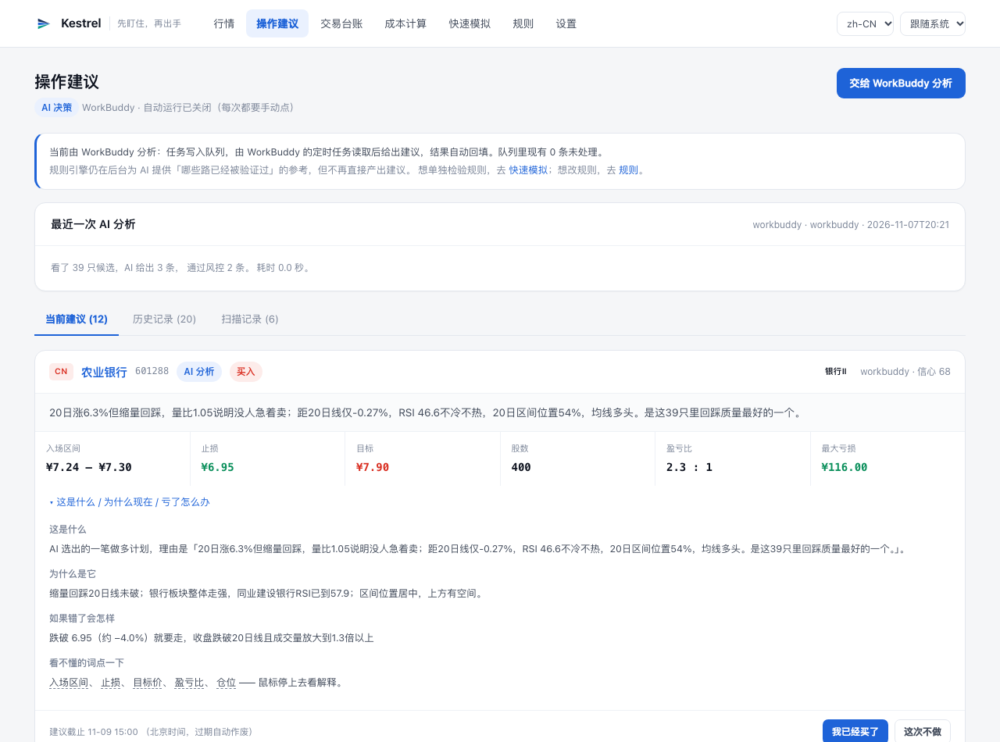
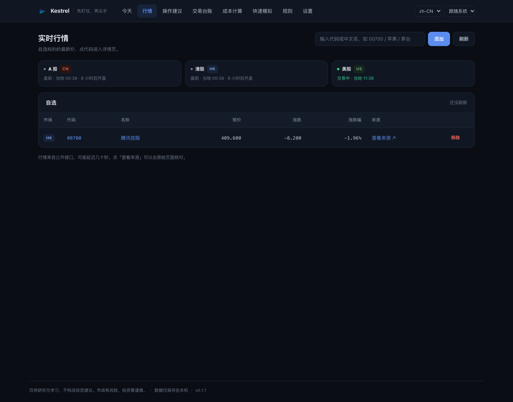
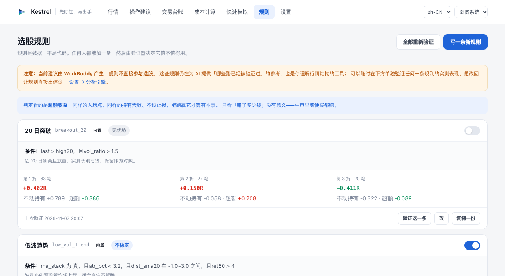
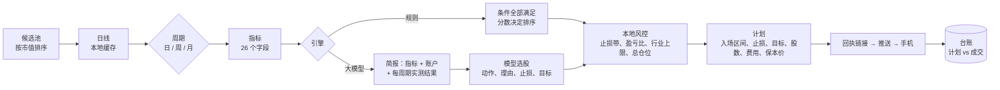

<div align="center">


<h1>Kestrel 隼</h1>

**先盯住，再出手。**

自托管的多市场选股助手与交易台账，给同时持有 A 股、港股、美股的人用。

<br/>

[](https://github.com/jukkakakaka/kestrel/actions/workflows/ci.yml) [](LICENSE) [](pyproject.toml) [](#安装)

[English](README.md) · [简体中文](README.zh-CN.md) · [文档](docs/) · [引擎](docs/engines.md) · [架构](docs/architecture.md)



</div>

---

大多数工具帮你**找到**一个交易机会。Kestrel 追问之后那个更难的问题：**你到底有没有按自己的计划做？**

每条计划都带着入场区间、止损、目标、股数、费用、真实保本价和截止时间，推到你的手机上，并附一个
一键回执页。点「已执行」、填真实成交价，计划与行为之间的偏差就变成一个可以改进的数字。

还有一件不太舒服的事：**它会告诉你自己的规则到底赚不赚钱。** 内置七条规则，
其中测下来不比「什么都不做」更好的，被自动停用了——而不是继续悄悄当成建议发给你。

## 一个开关，三个引擎

谁产生建议，是一个全局设置。操作建议页只有一个按钮，按钮上的字跟着它变。

| 引擎 | 谁做决定 | 速度 | 成本 |
| :--- | :--- | :--- | :--- |
| **规则** | 固定条件比较指标 | 即时 | 免费 |
| **大模型**（OpenAI 兼容） | 读指标、你的账户、以及每条规则的实测结果后自己选 | 约 30 秒 | 按 token |
| **WorkBuddy** | 同上，但走文件队列，由定时任务处理 | 分钟级 | 免费 |

两种 AI 模式下，**风控和仓位始终由本地代码强制**：模型给的股数一律不采纳，止损必须落在入场价下方
1.5%–15%，盈亏比至少 1.5，代码必须在候选列表里，同一行业不能扎堆。被拒绝的建议会带原因记录下来并显示在页面上——
一个会被过滤的模型，比一个看起来完美无缺的模型可信。

每张卡片都标明来源：`AI · deepseek-chat · 信心 68` 或 `趋势回踩 · 信号强度 80%`。

## 能做什么

- **三个市场，各自开关** —— A 股、港股、美股，不做的不开，省时间也更专注。
- **三个周期，自动推荐** —— 短线看日线、中线看周线、长线看月线（Beta）。默认按候选池广度、
  波动率、本金规模与实际费率判断「现在适合做什么周期」，你也可以一句话固定。
  周期一变，回测的持仓长度、止损带、计划有效期跟着一起变，不会只改表面。
- **是选股，不是体检** —— 每次从各市场按市值取候选池（默认 30 只），而不是只看你已有的持仓。
  冷启动约 85 只，缓存热了不到一秒。
- **规则是数据** —— 一条规则就是一个 JSON：条件、加分项、止损和目标的来源。在页面上写、改、复制；
  保存前先编译，写错指标名会直接告诉你哪个字段不认识。
- **规则必须证明自己** —— 三折滚动，基准是「同样入场、同样持有天数、不设止损」。打不过拿着不动的
  自动停用，但保留历史，换个行情可以重测。
- **计划是真的能下的** —— ATR 止损、2R 目标、按整手取整、含费用、算保本价。一手就超风险预算时
  直接拒绝并说明原因，而不是让它悄悄消失。
- **回执闭环** —— 签名短链走 ntfy / webhook / WeClawBot / 邮件；成交价和偏差落回数据库。
- **交易台账** —— 持仓、已平仓、打新；粘贴券商成交单自动解析；纪律统计对比「守规矩」和「破规矩」的收益。
- **成本引擎** —— 交易所征费 + 十套券商套餐，UI 里可增删改。1 万港币来回约 0.55%，1 千港币就变成 3.7%。
- **学习模式** —— 每条建议展开「这是什么 / 为什么现在 / 亏了怎么办」，40 条术语白话解释，可逐条关掉。
- **交易日历** —— 三市场交易时段、节假日、开市状态、下一个可交易收盘。
- **双语、暗色、本地优先** —— zh-CN / en，auto / light / dark，SQLite 落盘，无账号、无遥测。

## 界面

<table>
<tr valign="top">
<td width="50%" valign="top"><br/><sub><b>行情</b> —— 各交易所开休市状态，红涨绿跌，可跳到原始页面核对</sub></td>
<td width="50%" valign="top"><br/><sub><b>规则</b> —— 每条规则的逐折期望、相对持有的超额，以及判定徽章</sub></td>
</tr>
</table>

## 安装

**现成的 macOS 应用（11+）**

从 [Releases](https://github.com/jukkakakaka/kestrel/releases) 下载 `Kestrel-*.dmg`，拖进「应用程序」。
安装包是 ad-hoc 签名，首次启动前需要去掉隔离标记：

```bash
xattr -dr com.apple.quarantine /Applications/Kestrel.app
open /Applications/Kestrel.app
```

**从源码运行**

```bash
uv sync --extra desktop   # 需要 Python 3.11+
uv run kestrel init
uv run kestrel desktop    # 原生窗口
# 或者只用浏览器
uv run kestrel serve      # http://127.0.0.1:8000
```

关掉窗口就是退出。macOS 一个进程只有一个主线程，pywebview 占着它，而 AppKit 只允许在主线程
创建菜单栏图标——所以 mac 版没有托盘。想让扫描在没有窗口时继续跑，用 `kestrel serve`
（或 `kestrel desktop --browser`）。

**容器**

```bash
docker compose up         # http://127.0.0.1:8000，数据在命名卷里
```

**自己打包**

```bash
make package              # dist/Kestrel.app
make package-dmg          # dist/Kestrel-0.1.0.dmg
```

打包脚本会生成图标、签名，并**冒烟测试冻结后的副本能否渲染 `/advice`**——
「进程起来了但页面空白」这种失败模式，值得在 CI 里拦住，而不是在你手里发现。

## 一次分析怎么走



周期是**先**决定的，因为持仓时间决定了止损该多宽、计划该活多久。候选池广度、日均波幅、
本金规模和费率会一起给三档打分，选不出一档就退回日线并说明原因。

没有符合条件的标的时，页面会说明为什么——差多少分、被哪条约束否决——而不是硬凑一条出来填空。

## 写一条规则

```json
{
  "code": "pullback_quiet",
  "name": "缩量回踩",
  "conditions": [
    {"left": "ma_stack", "op": "is_true"},
    {"left": "dist_sma20", "op": "between", "value": [-2.5, 0.5]},
    {"left": "rsi14", "op": "between", "value": [40, 62]}
  ],
  "score": {"base": 0.45, "bonus": [
    {"when": {"left": "vol_ratio", "op": "<", "right": 1.15}, "add": 0.2}
  ]},
  "stop":   {"field": "low20"},
  "target": {"field": "high20"}
}
```

`GET /api/rules/schema` 返回完整的 JSON Schema、26 个字段的释义、操作符语义，以及每条内置规则作为范例。
规则页有「复制提示词」按钮，内容由同一组常量生成——把这段给任何模型，它就能写出合规规则，
不需要读这个仓库。

## 数据源

| 来源 | 费用 | 市场 | 说明 |
| :--- | :--- | :--- | :--- |
| 东方财富 | 免费 | A 股 / 港股 / 美股 | 主源，JSON |
| 腾讯 · 新浪 | 免费 | A 股 / 港股 / 美股 | GBK 兜底 |
| Yahoo | 免费，无需 Key | A 股 / 港股 / 美股 | 已与其他源交叉核对 |
| Finnhub · Alpha Vantage · Twelve Data · Polygon · Tiingo | 有免费额度或付费 | 视服务商 | 填 Key 即用 |

内置源可开关，关掉一个自动降级到下一个。自定义源支持 URL 模板（`{code}` `{market}` `{symbol}`
`{yf_symbol}` `{key}`）、JSON 点路径、毫单位换算系数，以及一个「先测一下」按钮——
保存前先看到解析出来的数字。

## 配置

除下面这些引导参数外，所有配置都存在数据库里，在界面上改。

| 环境变量 | 默认值 | 含义 |
| :--- | :--- | :--- |
| `KESTREL_HOME` | `./data`；打包版为 `~/Library/Application Support/Kestrel` | 数据库、缓存、日志、队列 |
| `KESTREL_HOST` | `127.0.0.1` | 监听地址 |
| `KESTREL_PORT` | `8000` | 端口 |
| `KESTREL_DEBUG` | `false` | 详细日志 |

## 诚实的边界

这是大多数 README 会略过的部分。

- **只有日线。** 没有盘口、没有资金流、没有财报预期。在这个信息集上，选股优势接近于零，
  规则页会如实显示这一点：期望是正的，但几乎全部来自 2:1 的盈亏结构，不是来自进场点。
- **长线是 Beta。** 月线只用得上量价，没有基本面，样本也最少。在 100 只票、约 25 年的历史上，
  七条内置规则里能凑够样本的通常只有两三条（`trend_pullback` 96 笔、`washout_bounce` 42 笔），
  其余显示「样本不足」；能判出来的也多是「无优势」或「不稳定」。页面会把总笔数一起显示，
  那是数据在说话，不是程序坏了。
- **真正在干活的是止损。** 和「同样入场、持有同样天数、不设止损」相比，每条内置规则的超额都接近零。
  请把它当成纪律和成本工具，而不是预言机。
- **周期建议也是经验规则**，不是模型：它读广度、波动、本金和费率，给出可解释的加权结论，
  可能判断错。你可以随时固定成自己想要的周期，页面会保留建议器当时的理由。
- **WorkBuddy 模式是异步的**，调度最细为每小时一次。
- **OCR 未实现。** 成交单请粘贴文本，本来也更准。
- **Windows 打包脚本还没进 CI**，虽然 spec 已经支持。

## 目录结构

```
src/kestrel/
  app.py            FastAPI 应用、路由、模板过滤器
  services/         扫描、分析、引擎调度、规则、候选池、日历、优势评估、成交单、桥接、
                    周期聚合(timeframe)、周期建议(advisor)
  strategies/       规则编译器、内置规则库、面向上游 AI 的 schema
  datasources/      数据源链、东财/腾讯/新浪、代码解析、预设、自定义源
  planning/         仓位计算、止损与目标定位、含费用的计划
  fees/             交易所征费模型、券商套餐
  web/              Jinja 模板与静态资源
  db/               表结构与版本化迁移
packaging/          PyInstaller spec、macOS 打包脚本、图标
```

## 文档

| 文档 | 内容 |
| :--- | :--- |
| [docs/engines.md](docs/engines.md) | 三种引擎、共用风控、AI 模式下各页面的角色 |
| [docs/architecture.md](docs/architecture.md) | 模块地图、数据流、存储 |
| [docs/fee-model.md](docs/fee-model.md) | 交易所征费与券商套餐 |
| [docs/notifications.md](docs/notifications.md) | 推送渠道、回执、签名方案 |
| [docs/ui-map.md](docs/ui-map.md) | 路由表与命名理由 |

## 参与

Issues 和 PR 都欢迎，见 [CONTRIBUTING.md](CONTRIBUTING.md)。
提交前 `uv run pytest`（107 项）和 `uv run ruff check src tests` 必须通过。

## 免责声明

Kestrel 是研究与学习工具。它**不提供投资建议、不预测价格、不下单**。它产出的任何内容都不构成
买卖任何证券的要约。市场有风险，决策由你负责。它最有用的功能，可能是告诉你「今天不该动」。

## 许可证

Apache-2.0 © Kestrel contributors
